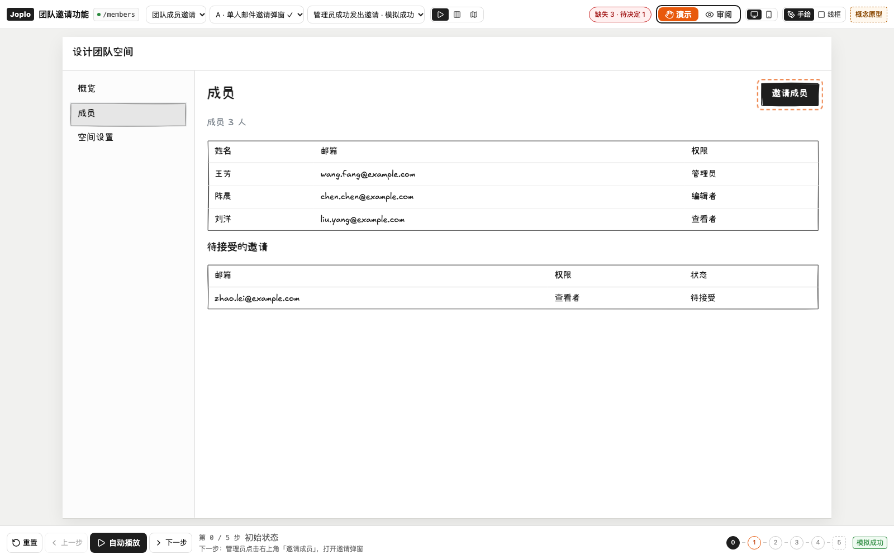

# Joplo

Joplo 是面向编码 Agent 的功能设计与演示工具：**动手实现之前，先和 AI 一起把功能做成低保真、可点击、可演示的原型，把每一种情况都看清楚。**

你和 Agent 在本地用 TSX 描述页面、功能方案、情况、规则和演示步骤，在看板中查看不同路径上的功能堆叠。方案选定后，构建出静态演示站给别人看。源文件是权威源，版本交给 Git。在看板里点选一个元素，会返回它的 `文件:行号`，Agent 只改你指着的那一处。



## 它解决什么问题

让 AI 直接写 HTML 原型，通常会遇到这些问题（详见 [DECISIONS.md](DECISIONS.md)）：

- **看不全**：只演示顺利路径，异常、权限、边界情况看不到。
- **想不到**：AI 只照你说的画，不会主动指出漏掉的情况。
- **改不快**：很难精确指出问题，AI 一改就整页重来。
- **留不住**：认可过的行为和理由没有沉淀，实现时照样自由发挥。
- **看不到整体**：每个功能单独设计，看不清合起来的产品是什么样子。

Joplo 的做法：

- 演示可以切换到每一种情况；
- 每个行为都绑定一条可交接的规则；
- 修改是局部的；
- 路径树就是整个产品的地图。

## 核心概念

| 概念 | 说明 |
| --- | --- |
| 路径（route） | `routes/` 下的文件夹即页面路径，共用 `layouts/` 里的外壳 |
| 功能（feature） | 目标、情况清单（cases）、共享规则、待决问题、选定方案（`pick`） |
| 方案（option） | 同一功能的不同做法，用 `on` 把元素堆叠到已有路径的插槽，或用 `routes` 新增路径 |
| 场景（scenario） | `flow(...).click().type().system()` 写成的演示步骤，可以手动点、逐步或自动播放 |
| 覆盖（coverage） | 每个情况是“已表达”“待决定”“缺失”还是“不适用”；未覆盖的情况自动标为缺口 |
| 写与看分离 | 本地看板给作者比较方案、查缺口；静态站只给观众看选定方案的演示，只读 |

## 安装

需要 Node.js 22+。发布到 npm 后（首个版本计划以 `beta` 标签发布 0.1.0，见 [docs/release.md](docs/release.md)），在任意目录：

```sh
npx joplo@0.1.0 init my-demo          # 生成项目，package.json 锁定 "joplo" 与 "@joplo/kit" 的同一精确版本
cd my-demo && npm install
npx joplo dev                          # 看板：http://127.0.0.1:4790/
```

`init` 结尾会按你用的包管理器（npm、pnpm、yarn、bun）打印这三条命令。之后 `npx joplo check`、`npx joplo build`、`npx joplo selection` 都使用项目里安装的版本；`npx joplo@latest …` 拉到的版本与项目不同时，也改用项目内的版本并提示怎样升级。截图命令 `joplo render` 另需 `npm i -D playwright && npx playwright install chromium`，其他命令不需要浏览器。

在本仓库里开发 Joplo 本身：

```sh
pnpm install
pnpm joplo guide                       # 直接运行 TS 源码，不需要构建
pnpm release:smoke                     # 打包所有包，在仓库外只用 tarball 跑通 init → install → check → build → dev → selection
```

仓库内的 `pnpm joplo` 把 `@joplo/kit` 解析到工作区源码，下文示例都在仓库根目录执行。不要改用 React 的 JSX runtime，否则会丢失 Joplo 数据和源位置。

## Agent 按需读取用法

运行 `pnpm joplo skill` 查看主题和实际行数，再读取这次需要的一两个主题，例如 `pnpm joplo skill authoring`、`pnpm joplo skill cases`。每个主题少于 150 行；`guide` 保留为 `skill authoring` 的别名。

在项目里安装一个短入口，让 Claude Code 或 Codex 等 Agent 发现用法：

```sh
pnpm joplo skill install examples/my-demo
# 没有 AGENTS.md 时也要为 Codex 创建入口：
pnpm joplo skill install examples/my-demo --agents-md
```

安装只写 `.claude/skills/joplo/SKILL.md` 指针；详细用法每次由当前 CLI 输出。已有 AGENTS.md 会更新其中的 Joplo 托管段。用户改过的 SKILL.md 不自动覆盖，用 `--diff` 预览，明确需要覆盖时用 `--force`。发布安装后的命令写法是 `npx joplo skill`，选中元素后用 `npx joplo selection` 精确定位。

## 快速开始

```sh
pnpm joplo init examples/my-demo --name "我的演示"
pnpm joplo dev examples/my-demo          # 打开看板：http://127.0.0.1:4790/
# 编辑 routes/、layouts/ 或 features/ 下的 TSX/TS，看板热更新
pnpm joplo check examples/my-demo        # 每个问题一行：文件:行:列 级别 代码 说明
pnpm joplo selection examples/my-demo    # 看板中选中元素的位置和前后三行源码
# 在 feature.ts 中设置 pick 后发布
pnpm joplo build examples/my-demo        # 输出到 examples/my-demo/dist
```

`dev` 默认使用 4790 端口，端口被占用时会直接报错；用 `--port <port>` 可以换端口。`build` 可以用 `--out-dir <dir>` 指定输出目录。

完整示例是团队邀请功能：两个方案，A 用弹窗，B 用批量邀请页。

```sh
pnpm joplo check examples/invite
pnpm joplo dev examples/invite
```

### 看板怎么用

- **演示模式**（默认）：只显示原型和步骤字幕。顶栏可以切换功能、方案和场景，并常驻显示缺口数量。
- **审阅模式**：左侧是路径树和情况列表，右侧是检查器。点任意元素，会看到它的规则、备注和源码位置。
- **比较方案**：选一个情况，分别看各方案如何处理。
- **浏览**：按路径查看当前选定的产品整体。
- 保存源文件后看板热更新，当前场景和步骤保持不变。

### 部署到 Cloudflare

构建产物是完全离线的纯静态站点，不含源码路径、规则、AI 假设和缺口，可以直接作为静态资源部署：

```sh
cd examples/my-demo
npx wrangler deploy --assets dist --name my-demo --compatibility-date 2026-11-01
```

部署使用你自己的 Wrangler 环境和账号。访问控制（如 Cloudflare Access）在部署侧处理，不属于 Joplo 的范围。

## 项目目录

```text
joplo.config.ts                    config：名称、默认布局、首页、主题
layouts/app.tsx                    layout：外壳、Outlet、共享 Slot
routes/page.tsx                    page：路径 /
routes/members/page.tsx            page：路径 /members
features/invite/feature.ts         feature：目标、cases、共享规则、questions、pick
features/invite/options/a.tsx      option：on 堆叠、routes 新路径、state、flow 场景
features/invite/sample.ts          自由组织的复用数据或模块
.joplo/selection.json              本地当前选中（不进 Git）
dist/                              构建产物（不进 Git）
```

`on` 把方案的元素堆叠到已有路径的命名插槽，`routes` 为方案新增静态页面。每个功能用 `pick: 'a'` 选择一个方案，build 只发布选中的方案；没有 `pick` 的功能不发布。

完整的创作速查运行 **`pnpm joplo guide`**（少于 150 行，适合直接交给 Agent）。

## 仓库结构

```text
packages/kit       @joplo/kit    创作 SDK：JSX 运行时、组件标记、builder（config/layout/page/feature/option/flow）
packages/core      @joplo/core   加载与编译（TSX → IR v2）、schema、播放器状态机、校验器、guide
packages/server    @joplo/server joplo dev（单进程 Vite 看板 + 热更新）、build（静态站）、render（截图）
packages/web       @joplo/web    看板与发布站界面、低保真手绘渲染器（Rough.js + Excalifont/小赖字体 + Motion）
packages/cli       @joplo/cli    joplo init / dev / check / selection / guide / build / render
examples/invite    当前格式的完整示例
examples/_v1       M0 阶段 JSON 格式的归档（含“用 Joplo 设计 Joplo”的自迭代项目）
docs/              CLI、看板、依赖许可证、ADR、截图
```

## 文档

- [docs/cli.md](docs/cli.md)：命令与参数
- [docs/web.md](docs/web.md)：看板、发布站与截图
- [docs/dependencies.md](docs/dependencies.md)：依赖与许可证
- [ADR-0001](docs/adr/0001-m0-architecture.md)：M0 架构（部分已被取代）
- [ADR-0002](docs/adr/0002-hugo-like-authoring.md)：当前的类 Hugo 创作与发布模型
- [DECISIONS.md](DECISIONS.md)：问题定义与全部产品决策（D1–D35）
- [Joplo-PRD-v0.1.md](Joplo-PRD-v0.1.md)：最初的产品需求草案（部分已被 DECISIONS 调整）

## 开发与测试

```sh
pnpm test                 # vitest：core / kit / cli / server / web
pnpm typecheck
pnpm test:e2e             # Playwright 端到端
pnpm docs:screenshots     # 重新生成 docs/screenshots
pnpm joplo check examples/invite --option invite.a-modal
pnpm joplo check examples/invite --format json
```

`check` 遇到 error 时退出码为 1，用法错误为 2；只有 warning/info 时退出码为 0。邀请示例故意保留了情况缺口和 AI 假设，原样检查没有 error。

## 路线图

- **已完成**：组件词汇从 shadcn 改为对齐 Mantine（D35）。布局用 `Stack`/`Group`/`AppShell` 属性表达，响应式写成 `{ base, sm, md }` 或 `visibleFrom`/`hiddenFrom`，按舞台宽度取值；看板顶栏可切换桌面 / 手机宽度预览。Agent 写得更短，也不用写 className。
- **下一步**：后端设计扩展（D34），用 D2 画架构图、状态机和数据模型，flow 步骤里用 `trace()` 让调用链与前端演示同步播放。
- **V2**：MCP、团队协作、评论同步、云端能力。

## 已知限制

- 只支持静态路径，不支持 `[id]` 这类动态段。原型没有真实的业务后端或数据。
- AI 假设不能标为已确认。行为只写在 flow 中，不能写 `onClick` 或其他函数属性。
- 作者的源文件会在本机加载、检查和构建时执行，所以导入别人的项目等同于运行别人的代码仓库。看板和发布站只消费编译后的 IR。
- 旧的 apply/get/history/restore/mcp 命令已退役。首版直接编辑文件，用 Git 保存版本。
