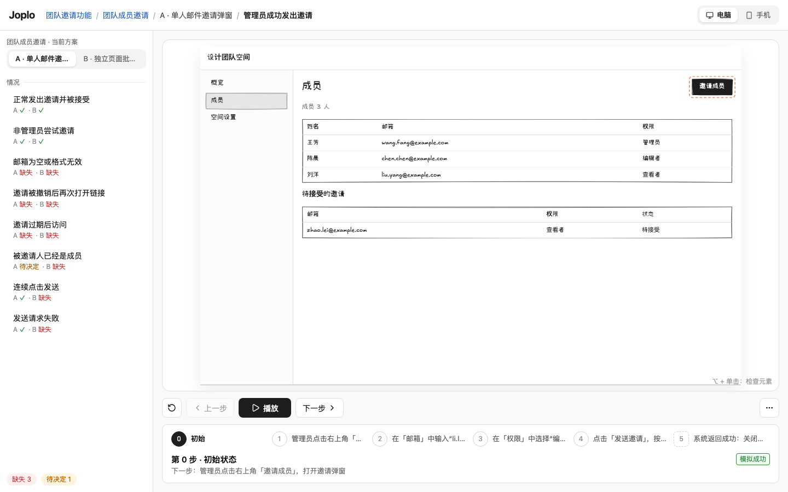

<p align="center"></p>

<p align="center">
  <a href="https://www.npmjs.com/package/joplo"></a>
  <a href="LICENSE"></a>
  <a href="https://nodejs.org"></a>
</p>

<p align="center">
  <a href="https://joplo.app/s/dn1MWCcnDW/"></a><br>
  <sub>☝️ A live Joplo badge. Click it to play Joplo's own design process, published by CI with <code>joplo share</code>.</sub>
</p>

<p align="center"><a href="README.md">English</a> · <a href="README.zh-CN.md">简体中文</a></p>

# Joplo

**Design the behavior before you build the feature.** Joplo helps you and your coding agent turn ideas into low-fidelity, interactive demos: explore edge cases, compare options, and keep the rules behind each decision.

Author pages and flows in TSX, review them in the local **Board**, then build a static **Published site** from the options you choose — or share it with one command and drop a playable badge or embedded player into a README, docs page, or blog post. Files are the source of truth; Git keeps the history. Option-click an element to give your agent its exact file and line.



## Quick start

Requires Node.js 22 or later and npm.

```sh
npx joplo@latest init my-demo
cd my-demo
npm install
npx joplo dev --open
```

Keep the Board process running. Edit the generated TSX files and watch the demo update. Running `npx joplo dev` from another project adds it to the same Board process. The default port is 4790; `--port <port>` selects a port when starting a new Board.

## What you can show

- **Board:** a home page with recent projects and their features, served by one local process.
- **Interactive demos:** breadcrumbs, a sidebar grouped by case, playback controls, a step strip, and a dedicated subtitle area.
- **Layers, Director, and Shots:** give each perspective its own page. The Director follows the flow, switches Layers, and moves the camera to each Shot. Viewers can take over, replay one Layer, zoom, pan, or go fullscreen.
- **Architecture demos:** `Diagram` groups nodes by business domain, `Sequence` walks a call chain in time order, `StateMachine` shows a lifecycle. Layout is automatic and stable across steps; `trace()` animates call paths and derives their states.
- **Inspection:** hold Option/Alt and click to open the rules and source drawer. Your agent can retrieve the selection and edit just that location.
- **Terminal and Phone:** model command-line interactions with `Terminal`; mobile pages use a `Phone` frame. Each page targets one device.
- **Themes:** choose from nine built-ins or add `themes/<name>.css`. Board settings can apply a Theme to one project or all projects.
- **Exports:** export the current step as an image or record a whole scenario locally. The Published site supports image export, Layers, Director, and fullscreen playback.
- **Share and embed:** `npx joplo share` uploads the Published site and prints a README badge; the same link also serves a preview image and a lightweight embedded player for docs and blogs. See [Share and embed](#share-and-embed).

## Work with an agent

### Install the agent skills

Two ways to give a coding agent (Claude Code, Codex, …) the Joplo skills `joplo` (build demos and hand them off for review) and `joplo-feedback` (receive local/Share feedback, acknowledge it promptly, and apply requested review results). Both install the same files from one template:

```sh
npx skills add Joplo-app/Joplo           # official skills from this repo; any repo, even before Joplo is installed
npx skills add https://github.com/Joplo-app/Joplo/tree/v0.2.13   # pin to a release tag (Joplo-app/Joplo@v… does not work: the skills CLI reads @… as a skill name)
npx joplo skill install                  # inside a Joplo project: skills matching the project's installed version
```

- Use `npx skills add` when you want agents to discover Joplo in any repository, for example to start a new prototype. The [skills CLI](https://github.com/vercel-labs/skills) installs to `.claude/skills/` for Claude Code and `.agents/skills/` for Codex.
- `npx joplo init` installs the same skills (and an `AGENTS.md` block) into new projects; pass `--no-skill` to skip. Installing skills first and then running `npx joplo init .` works: agent and Git files (`.git`, `.gitignore`, `.agents/`, `.claude/`, `AGENTS.md`, `skills-lock.json`, …) do not make the directory non-empty, skills already installed at the same version are skipped, and skills you edited are kept (`npx joplo skill install --force` replaces them). Other existing files still need `init . --keep`.
- Use `npx joplo skill install` inside a project that already has `joplo.config.ts`. It writes `.claude/skills/joplo*/SKILL.md`, updates untouched files when Joplo is upgraded, never overwrites files you edited (`--diff` to compare, `--force` to replace), and with `--agents-md` also writes a managed block into `AGENTS.md`.
- The skills are thin on purpose: a mental model, the start order, and common pitfalls. The detailed API always comes from `npx joplo skill <topic>`, which matches the installed version.

### Read guidance on demand

Read only the guidance the current task needs:

```sh
npx joplo skill
npx joplo skill authoring
npx joplo skill story
npx joplo skill cases
npx joplo skill demo
npx joplo skill review
npx joplo skill install --agents-md
```

The twelve topics are `authoring`, `story` (plan a demo, a PM's view of roles, goals, cases, and expected results, and how to write captions), `demo`, `focus` (where viewers look in each step: defaults, spotlight, highlight, callout, numbered, hold, redact), `diagram` (grouped architecture, sequence, and state diagrams, and shot framing), `components`, `cases`, `check`, `selection`, `review` (local listening, Share polling, prompt acknowledgement, version isolation, recovery, and best practices), `diff` (compare feature changes across builds and in PR CI), and `publish` (build, share, embed, review versions). `npx joplo components <Name>` prints the props and an example for one component. Each is under 150 lines. `npx joplo skill` starts with the mental model and the start order; user-edited skill files are protected. `guide` is an alias for `skill authoring`.

Use a second terminal while the Board is running:

```sh
npx joplo check
npx joplo outline
npx joplo selection
```

`outline` prints who each feature is for, its goal, each case with its expected result and coverage per option, and every scenario's steps and estimated duration. `check` reports one issue per line with a file, line, column, severity, and code. Errors exit with 1; usage errors exit with 2. Warnings and information exit with 0. After Option/Alt-clicking in the Board, `selection` returns the label and three lines of source on either side of the selected line.

## Local review

For local reviews, open the **Feedback & review** icon on the right of the demo to leave real feedback or confirm the option. The floating panel keeps the stage at its original size. Agents follow the whole project from a second long-running shell; `joplo dev` prints this exact command after it starts, and the feedback panel can copy it:

```sh
npx joplo feedback watch --local --follow --json
```

Submitted feedback streams as NDJSON, one event per line with `eventId`, `optionId` and `sessionId`. The follower covers every option and attaches by itself to the new review round that each source edit opens; approving one option does not stop it. It exits 1 when the board stops and 130 on Ctrl+C. To wait for one option version's approval or resume from a cursor, bind an exact session instead (`feedback list --local`, then `feedback watch --local --session <id> [--after <seq>]`, which exits 0 on approval). See the [CLI documentation](docs/cli.md).

For Share, use `npx joplo feedback watch --share <id> --option <feature.option> --interval 15 --json`. Polling defaults to 15 seconds, configurable from 10 to 30. The current Cloud endpoint exposes a pending-feedback snapshot, so records resolved/applied between polls can be missed; see the [Cloud follow-up requirements](docs/cloud-feedback-watch.md).

## Project layout

```text
joplo.config.ts
layouts/app.tsx
routes/page.tsx
routes/members/page.tsx
features/invite/feature.ts
features/invite/options/a.tsx
shared/
themes/brand.css
.joplo/selection.json
dist/
```

Routes follow folders. Layouts provide the shell and named Slots; Options add content to those Slots or define new routes. A Feature holds its goal, cases, rules, and `pick`. Scenarios describe behavior with `flow()`. Use `@joplo-app/kit` for the authoring API and `@joplo-app/kit/ui` for components named and configured like Mantine.

Reuse modules inside the project with `shared/`. Keep runtime state in `.joplo/` and build output in `dist/` out of Git. See the authoring topic for exact APIs and [Themes](docs/themes.md) for CSS variables.

## Build and publish

Set each Feature's `pick` to its chosen Option filename, then:

```sh
npx joplo check
npx joplo build
npx wrangler deploy --assets dist
```

Build publishes only the selected Options. The Published site shares the Board's player layout and keeps the demo, subtitles, Layers, and Themes. Rules, assumptions, coverage gaps, and source locations stay on the authoring side. Image export works in the browser; video export is local only.

Use your own Wrangler account and configure the site name and compatibility date for deployment. The output also works with other static hosts. See [CLI reference](docs/cli.md) for output directories, overwrite options, and screenshots.

## Share and embed

Skip hosting entirely: `joplo share` checks, builds, and uploads the Published site to Joplo Cloud, then prints everything you need to put the demo in front of people.

```sh
npx joplo login          # once
npx joplo share
```

```text
Published https://joplo.app/s/<share-id>/
Permanent link
Add to README: [](https://joplo.app/s/<share-id>/)
More embed options: https://cloud.joplo.app/shares/<share-id>
```

Every share link comes with three ways to show it:

| Where | Use | What viewers get |
| --- | --- | --- |
| README, issue, PR | `[](<link>)` — the `Add to README` line | A playable badge, like the one [at the top of this page](#joplo), that opens the full demo |
| Social cards, link previews | `<link>preview.png` | A 1200×630 image of the default scenario's first screen |
| Docs, blogs, product pages | `<iframe src="<link>?embed=1" …>` | A compact player: cover with a big play button, then step controls, scenario switcher, and fullscreen |

The embed code from `--format json` or the Cloud console is ready to paste:

```html
<iframe src="https://joplo.app/s/<share-id>/?embed=1" title="<title> · Joplo 演示"
  style="width:100%;aspect-ratio:16/10;border:0"
  allow="fullscreen *" allowfullscreen loading="lazy"></iframe>
```

- Add `&scenario=<scenario id>` to start from a specific scenario (`npx joplo outline` lists the ids) and `&autoplay=1` to skip the cover. Invalid values fall back to the cover and the default scenario.
- Keep `allow="fullscreen *"`: the share page runs in a CSP sandbox, so plain `allow="fullscreen"` blocks fullscreen in Chromium, Firefox, and WebKit. Without it the player falls back to opening the demo in a new tab.
- The embedded player makes no network requests and does not use storage. GitHub strips iframes from Markdown, so use the badge there.
- `--scenario <id>` and `--feature <id>` share only part of a project. Everything else is cut at build time, not hidden.
- Free links expire after one hour, and their badge then shows "expired". Pro links are permanent, and re-sharing updates the same link, so badges and embeds you already published stay current.
- In CI, set `JOPLO_API_KEY` and run `npx joplo share --new --pr <number> --format json` for a PR preview. Agents should copy `data.embed.markdown` / `data.embed.iframe` as is rather than building URLs themselves.

The preview image needs the optional export component (`npx joplo setup export`); without it, share still succeeds and uses a generic card. Details: [`share` in the CLI reference](docs/cli.md#share) and [embed mode](docs/web.md#嵌入模式).

## Compare feature changes

Compare two real public builds and get one review site that plays both versions:

```sh
npx joplo diff before-site after-site --out diff-site
```

Added scenarios play the new version, removed scenarios play the old one, and modified scenarios stack both players in one frame: press Space to flip between old and new in place, or switch to side by side. The sidebar lists every change by caption, and each change card shows what was inserted, deleted, or edited, with the old → new result values. Stable `.key()` identities keep steps aligned across insertions; ambiguous legacy matches stay marked as uncertain. In PR CI, `diff prepare` pins the baseline, the PR is built without credentials, and `diff publish` runs separately with them. A demo change is not proof that the real implementation changed.

Run `npx joplo skill diff` for the version-matched workflow and recovery steps. See the [CLI](docs/cli.md#diff跨版本功能变化) and the [full guide with a safe CI example](docs/feature-diff/README.md).

## Examples

| Example | What to explore |
| --- | --- |
| [examples/invite](examples/invite) | Compare an invitation dialog with a batch invitation flow |
| [examples/agent-arch](examples/agent-arch) | Layers, Director, grouped `Diagram`, `Sequence`, `StateMachine`, and `trace()` for an agent architecture |
| [examples/joplo](examples/joplo) | Joplo’s own evolving design workspace: real feature alternatives, interaction prototypes and documented decisions |

[](https://joplo.app/s/dn1MWCcnDW/)

The self-design workflow publishes a separate feature comparison for same-repository PRs after CI passes, and updates this fixed link after successful main CI. See [automation and recovery](docs/self-design/CI-CONTRACT.md); npm releases remain tag-driven.

## Develop in this repository

```sh
pnpm install
pnpm joplo dev examples/invite --open
pnpm typecheck
pnpm test
```

The workspace uses `joplo` as the command entry point, with `@joplo-app/kit`, `@joplo-app/core`, `@joplo-app/cli`, `@joplo-app/server`, and `@joplo-app/web` behind it. The CLI loads the server only for `dev`, `build`, `render`, and `setup`. Writing demos, `dev`, `check`, `build`, and `share` need no browser. Screenshots (`render`), image and video export in the board, and share preview images use an optional export component (Playwright + Chromium, about 100 MB) that Joplo installs once under `~/.joplo`, never into your project:

```sh
npx joplo setup export
```

The board's Export menu can also install it with one click.

See [dependencies and licenses](docs/dependencies.md) and the [npm release workflow](docs/release.md).

## Documentation

- [CLI reference](docs/cli.md)
- [Board and Published site](docs/web.md)
- [Embed mode](docs/web.md#嵌入模式)
- [Feature diff](docs/feature-diff/README.md)
- [Themes](docs/themes.md)
- [Authoring model](docs/adr/0002-hugo-like-authoring.md)
- [Demo model and architecture](docs/adr/0003-demo-model.md)
- [Product decisions](DECISIONS.md)

Run `npx joplo skill` for task-focused authoring guidance that matches your installed version.

## Scope and execution boundary

Joplo models behavior; it does not run a real product backend. Routes must be static. A mobile experience needs its own page or demo. AI assumptions cannot be marked as confirmed without a real user decision, and interaction belongs in `flow()` rather than `onClick`.

Author modules execute on your machine during loading, checks, and builds. Only run projects you trust. The Board and Published site consume compiled IR. Local review records stay in the project directory. MCP, multi-user collaboration, and real-time cloud comment sync are outside this local release.

## License

[PolyForm Noncommercial 1.0.0](LICENSE). Joplo is free for personal and other noncommercial use. Commercial use, including use at a company and building competing products, needs a Joplo Cloud subscription or a separate commercial license; see [COMMERCIAL.md](COMMERCIAL.md). Versions 0.2.15 and earlier were released under Apache-2.0. Bundled fonts use [SIL OFL 1.1](packages/web/src/fonts/OFL.txt).
