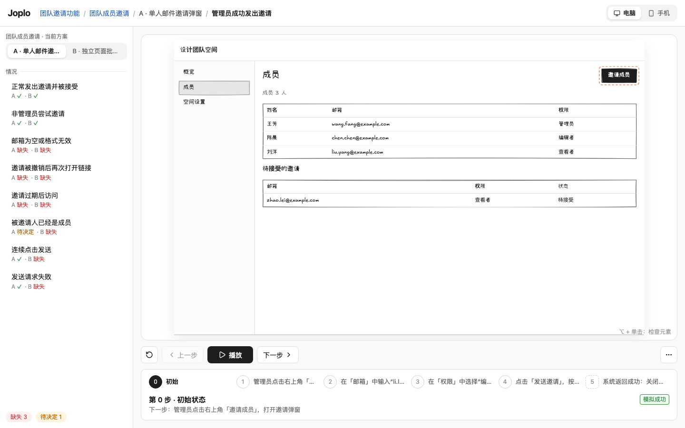

<p align="center"></p>

<p align="center">
  <a href="https://www.npmjs.com/package/joplo"></a>
  <a href="LICENSE"></a>
  <a href="https://nodejs.org"></a>
</p>

<p align="center">
  <a href="https://joplo.app/s/dn1MWCcnDW/"></a><br>
  <sub>☝️ 这就是 Joplo 徽章：点开就能播放 Joplo 自己的设计过程，由可信 CI 发布。</sub>
</p>

<p align="center"><a href="README.md">English</a> · <a href="README.zh-CN.md">简体中文</a></p>

# Joplo

**先把功能想清楚、演示清楚，再动手实现。** Joplo 帮你和编码 Agent 把想法变成低保真、可点击的演示，探索边界情况、比较方案，并保留每个决定背后的规则。

用 TSX 创作页面和流程，在本地看板（Board）查看，选定方案后构建静态发布站（Published site）；也可以一条命令分享出去，把可播放的徽章或嵌入播放器放进 README、文档和博客。源文件是权威源，版本交给 Git。按住 ⌥（Option/Alt）单击元素，就能把精确的文件和行号交给 Agent。

项目是作品集，结构是作品 → 切片 → 步骤。`work()` 是唯一作品入口：独立作品写在 `works/<key>.tsx`，功能下的作品写在 `features/<f>/works/<key>.tsx`，都用 `title` / `summary`。功能是叠在作品上的评审层，添加情况、覆盖与选定；它下面的作品在界面上叫“方案”。讲解片用 `chapter()` 切片，用 `--work <键>` 只发布一件。详见[作品模型](docs/work-model.md)。



## 快速开始

需要 Node.js 22 或更新版本，以及 npm。

```sh
npx joplo@latest init my-demo
cd my-demo
npm install
npx joplo dev --open
```

默认模板位于主仓库 `templates/starter`，按当前 CLI 的 `v<版本>` tag 下载。它显式安装并启用 ui、diagram、content、alda 四个标准插件；引擎不加载默认插件。离线用 `npx joplo init my-demo --template ./templates/starter`，自定义远端用 `--template github:owner/repo/path#ref`；私有仓库读取 `GITHUB_TOKEN` 或 `gh auth token`。下载与模板校验失败不会留下半截项目。

保持看板进程运行，编辑生成的 TSX 文件，演示会自动更新。在另一个项目中运行 `npx joplo dev`，会把项目加入同一个看板进程。默认端口为 4790；启动新看板时可用 `--port <port>` 指定端口。

## 能演示什么

- **看板 Board**：首页列出最近打开的项目及其功能，一个本地进程服务多个项目。
- **交互演示**：面包屑、按情况分组的左栏、播放控制、步骤条和独立字幕区。
- **层级 Layers、导演 Director、镜头 Shots**：每种视角有独立页面。导演按流程切换层级、移动镜头；观众可以接管、只重放一层、缩放、平移或全屏观看。
- **架构演示**：`Diagram` 按业务域分组画架构，`Sequence` 按时间讲一次调用，`StateMachine` 讲生命周期；布局自动且每一步都不变，`trace()` 播放调用链并推算状态。
- **检查元素**：按住 Option/Alt 单击，打开规则与源码抽屉；Agent 读取选中位置后只改那一处。
- **Terminal 与 Phone**：用 `Terminal` 表达命令行交互；手机页面使用 `Phone` 外框。每个页面只面向一种设备。
- **主题 Themes**：九个内置主题，也可添加 `themes/<name>.css`；看板设置可对当前项目或所有项目应用主题。
- **导出**：导出当前步骤图片，或在本地录制整个场景。发布站支持图片导出、层级、导演与全屏播放。
- **朗读**：自动播放时把每一步读出来。声音来源有浏览器朗读、Joplo Cloud 朗读（`npx joplo login` 登录即用，不用配 Key，按字数计费，登录后默认用它），以及自带 Key 的官方 OpenAI、ElevenLabs。在看板里生成音频，或用 `npx joplo voice`（`--dry-run` 先估算字数）；`npx joplo whoami` 显示还剩多少字，看板首页显示空间与朗读用量。生成的音频随 build 和分享带上，见[朗读](docs/web.md#朗读d74)。
- **分享与嵌入**：`npx joplo share --private --no-review` 上传发布站并打印 README 徽章；同一个链接还提供预览图和给文档、博客用的精简嵌入播放器，见[分享与嵌入](#分享与嵌入)。

## 与 Agent 配合

### 安装 Agent 技能

有两种方式给编码 Agent（Claude Code、Codex 等）装上 Joplo 的技能 `joplo`（做演示并交付评审）与 `joplo-feedback`（接收本地／Share 反馈、及时回执并按评审结论改源码）。两种安装方式使用同一份模板，内容一致：

```sh
npx skills add Joplo-app/Joplo           # 本仓库的官方技能；任何仓库都能用，装 Joplo 之前也行
npx skills add https://github.com/Joplo-app/Joplo/tree/v0.2.13   # 固定到某个发布 tag（Joplo-app/Joplo@v… 不能用：skills CLI 把 @ 后面当技能名）
npx joplo skill install                  # 在 Joplo 项目里：与项目安装的版本一致
```

- 想让 Agent 在任何仓库里都能发现 Joplo（例如从零开始做一个原型），用 `npx skills add`。[skills CLI](https://github.com/vercel-labs/skills) 会装到 Claude Code 的 `.claude/skills/` 和 Codex 的 `.agents/skills/`。
- `npx joplo init` 新建项目时默认装好引擎技能、主题、四个插件技能与索引（以及 `AGENTS.md` 托管段），用 `--no-skill` 跳过。先装技能再 `npx joplo init .` 也可以：Agent 与 Git 文件（`.git`、`.gitignore`、`.agents/`、`.claude/`、`AGENTS.md`、`skills-lock.json` 等）不算目录非空；已装好的同版本技能会跳过，你改过的技能会保留（`npx joplo skill install --force` 才覆盖）。还有其他文件时仍需 `init . --keep`。
- 已经有 `joplo.config.ts` 的项目，用 `npx joplo skill install`：写入 `.claude/skills/joplo*/SKILL.md`，升级 Joplo 后自动更新没改过的文件，不覆盖你改过的文件（`--diff` 看差异、`--force` 覆盖），加 `--agents-md` 还会在 `AGENTS.md` 里写一段托管说明。
- 技能故意很薄：只有心智模型、起步顺序和最常见的坑；具体 API 一律以 `npx joplo skill <主题>` 为准（与安装的版本一致）。

### 按需读取用法

只读取当前任务需要的用法：

```sh
npx joplo skill
npx joplo skill authoring
npx joplo skill story
npx joplo skill content
npx joplo skill cases
npx joplo skill demo
npx joplo skill review
npx joplo skill install --agents-md
```

引擎主题包括 `authoring`、`story`、`demo`、`focus`、`cases`、`check`、`selection`、`review`、`diff`、`publish`、`plugins`。组件与具体画面手法由项目插件提供：`joplo skill ui/components`、`diagram`、`content`、`alda`，以及各自的子主题。`joplo skill install` 写入引擎入口、主题文件、插件入口与主题索引；增删插件后重跑即可同步，用户改过的技能受保护。常见坑逐条保留，开发完成后的 feedback watch 仍是 Required。

看板运行时，在另一个终端执行：

```sh
npx joplo check
npx joplo outline
npx joplo selection
```

`outline` 列出每个功能给谁、解决什么，每个情况的期望结果与各方案的覆盖，以及每个场景的步数和估算时长。`check` 每个问题输出一行，包含文件、行、列、级别与代码。error 退出 1，用法错误退出 2，只有 warning/info 时退出 0。在看板中按住 Option/Alt 单击后，`selection` 返回标签、定位和目标行前后各三行源码。

## 本地评审

本地评审时，点演示右侧「反馈与评审」图标填写反馈，或直接确认方案。浮层不会挤压演示页面。Agent 在另一个常驻终端里跟住整个项目；`joplo dev` 启动后会打印这条命令，反馈浮层里也能复制：

```sh
npx joplo feedback watch --local --follow --json
```

反馈逐条以 NDJSON 输出，每条带 `eventId`、`workId`、`sessionId`。它覆盖所有方案，改源码后自动接上新一轮评审；某个方案确认不会让它结束。看板停止时退出 1，Ctrl+C 退出 130。需要等待某个方案版本的确认、或从游标补收时，改用精确会话：先 `feedback list --local`，再 `feedback watch --local --session <id> [--after <序号>]`，确认后退出 0。详见[本地评审命令](docs/cli.md#review本地评审与流式监听)。

Share 通过同一个入口轮询：`npx joplo feedback watch --share <id> --work <功能.方案> --interval 15 --json`。默认每 15 秒，可设 10–30 秒。当前是快照轮询，已解决／已写回记录的完整补收需要 Cloud 扩展，详见[接口说明](docs/cloud-feedback-watch.md)。

## 项目结构

```text
joplo.config.ts
layouts/app.tsx
routes/page.tsx
routes/members/page.tsx
features/invite/feature.ts
features/invite/works/a.tsx
shared/
themes/brand.css
.joplo/selection.json
dist/
```

文件夹定义页面路径；布局提供外壳与命名插槽；方案往插槽里堆叠内容，也可新增路径。功能记录目标、情况、规则和 `pick`，场景用 `flow()` 表达行为。创作 API 从 `@joplo-app/kit` 导入，组件从 `@joplo-app/plugin-ui` 导入，名称与属性对齐 Mantine。

项目内可用 `shared/` 复用模块；本地运行状态 `.joplo/` 和构建产物 `dist/` 不进入 Git。具体 API 见 authoring 主题，CSS 变量见[主题文档](docs/themes.md)。

## 构建和发布

在每个功能的 `pick` 中写选定方案的文件名，再执行：

```sh
npx joplo check
npx joplo build
npx wrangler deploy --assets dist
```

build 发布各功能选定的作品和已准备好的独立作品；草稿与没有切片的作品留在本地。发布站与看板共用演示页布局，保留演示、字幕、层级和主题；规则、假设、覆盖缺口和源码位置留在创作侧。图片可在浏览器导出，视频仅本地导出。

部署使用你自己的 Wrangler 账号，并配置站点名与兼容日期；产物也能交给其他静态托管服务。输出目录、覆盖选项与截图用法见 [CLI 文档](docs/cli.md)。

## 分享与嵌入

不想自己托管时，`joplo share --private --no-review` 会检查、构建并把发布站上传到 Joplo Cloud，然后打印把演示放到别人面前所需的一切：

```sh
npx joplo login          # 只需一次
npx joplo share --private --no-review
```

```text
Published https://joplo.app/s/<share-id>/
Permanent link
Add to README: [](https://joplo.app/s/<share-id>/)
More embed options: https://cloud.joplo.app/shares/<share-id>
```

每个分享链接都有三种展示方式：

| 放在哪里 | 用什么 | 观众看到什么 |
| --- | --- | --- |
| README、Issue、PR | `[](<链接>)`，即 `Add to README` 那一行 | 一个可点击的徽章（就像[本页顶部](#joplo)那个），打开完整演示 |
| 社交卡片、链接预览 | `<链接>preview.png` | 默认场景首屏的 1200×630 图片 |
| 文档、博客、产品页 | `<iframe src="<链接>?embed=1" …>` | 精简播放器：先显示带大播放按钮的封面，播放后有逐步控制、场景切换和全屏 |

`--format json` 或云端控制台给出的嵌入代码可以直接粘贴：

```html
<iframe src="https://joplo.app/s/<share-id>/?embed=1" title="<标题> · Joplo 演示"
  style="width:100%;aspect-ratio:16/10;border:0"
  allow="fullscreen *" allowfullscreen loading="lazy"></iframe>
```

- 加 `&scenario=<场景 id>` 从指定场景开始（`npx joplo outline` 列出场景 id），加 `&autoplay=1` 跳过封面直接播放。参数写错时照常显示封面、从默认场景开始。
- 保留 `allow="fullscreen *"`：分享页运行在 CSP 沙箱里，只写 `allow="fullscreen"` 时 Chromium、Firefox、WebKit 都会拒绝全屏；去掉后播放器退回为在新标签页打开演示。
- 嵌入播放器不发网络请求、不依赖存储。GitHub 会过滤 Markdown 里的 iframe，README 里请用徽章。
- `--scenario <id>`、`--work <id>` 只分享项目的一部分；范围外的内容在构建时就被裁掉，不是隐藏。
- 链接永久有效，免费账号也一样；限制的是账号空间（免费 100 MB、Pro 5 GB，按所有在线分享的原始大小计算），`share` 会打印用了多少。再次 share 更新同一个链接，已经贴出去的徽章和嵌入会跟着更新。
- CI 中设置 `JOPLO_API_KEY`，用 `npx joplo share --private --no-review --new --pr <number> --format json` 发布 PR 预览。Agent 应原样使用 `data.embed.markdown` / `data.embed.iframe`，不要自己拼地址。

预览图需要可选的导出组件（`npx joplo setup export`）；没有时 share 照常成功，分享页使用通用卡片。详见 [CLI 文档的 share](docs/cli.md#share) 和[嵌入模式](docs/web.md#嵌入模式)。

## 比较功能变化

比较两个真实的公开构建，得到一个同时播放两个版本的差异站点：

```sh
npx joplo diff before-site after-site --out diff-site
```

新增场景播放新版，删除场景播放旧版；修改的场景把两版播放器叠在同一画面，按空格原地切换旧版／新版，也可以切到并排。左栏按字幕列出每一处变化，变化卡说明是插入、删除还是改了什么，并列出结果的旧 → 新值。稳定的 `.key()` 身份让插入步骤后仍能对齐；无法确定的旧版匹配会明确标为不确定。PR CI 中先用 `diff prepare` 固定基线，在没有凭证的环境构建 PR，再单独用凭证运行 `diff publish`。演示变化不等于真实实现已经改变。

运行 `npx joplo skill diff` 获取与当前版本一致的操作、成功判断与恢复指南。详见 [CLI](docs/cli.md#diff跨版本功能变化) 和[完整指南／安全 CI 示例](docs/feature-diff/README.md)。

## 示例

| 示例 | 可以看什么 |
| --- | --- |
| [examples/invite](examples/invite) | 比较邀请弹窗与批量邀请流程 |
| [examples/agent-arch](examples/agent-arch) | 用层级、导演、分组的 `Diagram`、`Sequence`、`StateMachine` 与 `trace()` 演示 Agent 架构 |
| [examples/joplo](examples/joplo) | 用 Joplo 设计 Joplo：统一的真实功能方案、交互原型与设计决策 |

[](https://joplo.app/s/dn1MWCcnDW/)

自设计工作流在同仓 PR 的 CI 通过后生成独立功能差异预览，在 main CI 通过后更新这个固定链接。配置与恢复见[自动发布说明](docs/self-design/CI-CONTRACT.md)；npm 仍按 tag 单独发布。

## 仓库内开发

```sh
pnpm install
pnpm joplo dev examples/invite --open
pnpm typecheck
pnpm test
```

工作区用 `joplo` 作为命令入口，内部包为 `@joplo-app/kit`、`@joplo-app/core`、`@joplo-app/cli`、`@joplo-app/server`、`@joplo-app/web`。CLI 只在 dev/build/render/setup 时加载服务端。写演示、dev、check、build、share 都不需要浏览器；截图（render）、看板里导出图片和视频、share 的预览图用可选的导出组件（Playwright + Chromium，约 100 MB），由 Joplo 装在 `~/.joplo` 下，一台电脑装一次，不装进项目：

```sh
npx joplo setup export
```

也可以在看板的「导出」菜单里一键安装。

详见[依赖与许可证](docs/dependencies.md)和 [npm 发布流程](docs/release.md)。

## 文档

- [CLI 文档](docs/cli.md)
- [看板与发布站](docs/web.md)
- [嵌入模式](docs/web.md#嵌入模式)
- [功能差异](docs/feature-diff/README.md)
- [主题](docs/themes.md)
- [创作模型](docs/adr/0002-hugo-like-authoring.md)
- [演示模型与架构](docs/adr/0003-demo-model.md)
- [产品决策](DECISIONS.md)

运行 `npx joplo skill`，按需获取与项目安装版本一致的创作说明。

## 范围与执行边界

Joplo 表达设计行为，不运行真实业务后端；只支持静态路径，手机版需要单独的页面或演示。AI 假设未经用户决定不能标为已确认，交互写在 `flow()` 中，不写 `onClick`。

作者模块在本机加载、检查和构建时执行，只运行可信项目。看板和发布站只消费编译后的 IR。本地反馈保存在项目目录内，不包含 MCP、多人协作或云端评论实时同步。

## 参与贡献

Joplo 接受 issue，不接受 pull request。bug 和功能需求请在 [issue](https://github.com/Joplo-app/Joplo/issues/new/choose) 中提交，详见 [CONTRIBUTING.md](CONTRIBUTING.md)。安全问题请发邮件到 [support@joplo.app](mailto:support@joplo.app)。

## 许可证

[PolyForm Shield 1.0.0](LICENSE)。任何人都可以免费使用 Joplo，包括在公司里和商业项目中使用；不得用它提供与 Joplo 或 Joplo Cloud 竞争的产品，详见 [COMMERCIAL.md](COMMERCIAL.md)。0.2.15 及更早的版本以 Apache-2.0 发布。随包字体使用 [SIL OFL 1.1](packages/web/src/fonts/OFL.txt)。

模板显式启用的 `@joplo-app/plugin-content` 提供 `content:Canvas`、`camera()`、FLIP 通用属性与 `content:studio` 主题。从插件包直接导入创作 API，并在 package.json 和 config.plugins 显式声明。`npx joplo skill content` 介绍连续讲解内容的做法，示例见 [llm-explainer](examples/llm-explainer)，契约见 [插件架构](docs/plugins.md)。章节用 `chapter()` 接力，分镜用 `joplo render --sheet --columns 3`。

标准 UI 和 HTML 由 `@joplo-app/plugin-ui` 提供：直接从该包导入，并在 config.plugins 显式启用，IR 使用 `ui:Button` / `ui:div`。`joplo components` 读取当前插件清单，`joplo skill ui/components` 提供完整 UI 用法。diagram 的组件与 trace 从 `@joplo-app/plugin-diagram` 导入。见[插件契约](docs/plugins.md)。

### 分享可见性与作品集

每次发布都必须选择 `--public` / `--private` 与 `--review` / `--no-review`；Agent 发布前先问用户两件事，不能代选。CI 在 workflow 固定参数；非交互缺项退出 2，交互终端逐项按键确认。公开进入 `show.joplo.app/@用户名` 作品集并被搜索引擎收录，项目名、简介与目标应适合搜索结果，不能包含未公开信息。私密只有拿到链接的人能看。

`--review` 同时发布主分享和包含所有方案、可评论的独立私密评审链接：JSON 分别为 `data.url` 和 `data.review.url`。范围内没有 picked 场景时，仅发布私密评审版（`data.mode: "review"`，链接为 `data.url`），普通分享不更新。PR 预览与范围分享只能私密；对比发布始终私密、不支持评审版。看板发布浮层提供同样的选择，新建整项目默认公开，更新沿用当前可见性（旧记录按私密）。公开结果给出作品详情或设置用户名入口；官方分享的播放器顶栏和结束画面有“作者 · 更多作品”，本地构建、导出和嵌入不显示。

《[同一个按钮的 40 年](examples/button-40-years)》把四个年代做成可暂停体验的界面，使用开源复古样式、同物件 motion 与原创 Alda 配乐。跨场景的时间轴拖拽可在目标 `flow` 声明 `actionEntry: 'after'`，确认后直接看到动作结果；默认仍进入动作之前，适合教学预演。素材与许可证先收集到 `assets/`，经验由引擎与插件技能提供。
