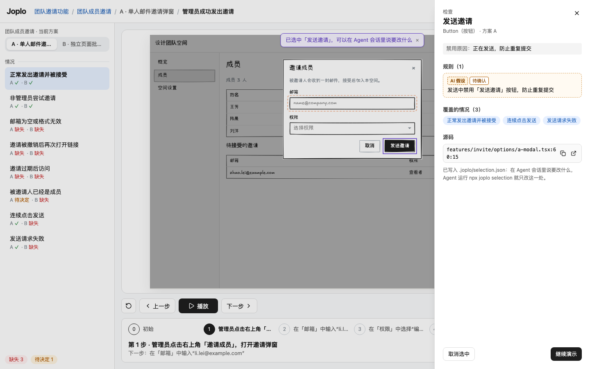

# Joplo 看板与发布站

在作者项目内启动：

```sh
npx joplo dev --open
```

看板只监听本机，默认端口 4790。同一 `JOPLO_HOME` 下一个进程服务多个项目；其他目录再次运行 `npx joplo dev` 会注册项目并返回已有看板链接。参数见 [CLI 文档](cli.md)。

## 首页与项目

左栏按最近打开排序列出项目名和缩写的目录（编译出错写错误数，目录不存在写“找不到”），↑↓ 切换；底部是“添加项目：在项目目录里运行 npx joplo dev”。右侧是所选项目的名字、说明、目录、“N 个功能 · 已选定 a / n”和编译状态；功能卡片整张可点（Enter 也可以），打开选定方案的演示（没有选定时打开第一个方案），卡片上有缩略图（选定方案第一个场景的初始画面，用这个项目的外观，进入视口才渲染）、选定方案、方案数和覆盖小结。首次打开显示标志和三条可复制的开始命令。

项目记录保存在 `~/.joplo/projects.json`。目录移动后可从列表移除失效记录，再从新目录打开；移除记录不删除项目文件。某个项目编译失败不影响其他项目，首页和演示页显示文件定位及说明；有上次成功结果时继续展示，修复保存后自动更新。

顶栏的「外观」（或按 `T`）打开外观浮层，配色、字体、线条分开选：首页改所有项目的默认，演示页只改当前项目。选择保存在本机 settings.json，不改作者 config；发布站只使用 config 的主题，不支持字体和线条。旧的 `#/settings` 链接会跳到首页并打开外观浮层。九个内置主题、选择优先级和完整变量见[主题文档](themes.md)。

## 演示页

| 区域 | 用法 |
| --- | --- |
| 顶栏 | 品牌回到首页；「项目 ▾」「功能 ▾」下拉切换项目和功能（带缺口数）；「检查」开关（⌥）、「外观」（T）、「导出 ▾」、全屏（F） |
| 左栏 | 方案行（字母、名字、已选定、缺失 / 待决定），点一下切换方案、情况保持；情况行显示当前方案的状态图标和其他方案的小标（悬停写“B：缺失”，点一下切到 B 看同一个情况）；悬停方案或情况弹出卡片；底部缺口汇总点一下复制 `npx joplo check --option <方案>` |
| 舞台框 | 画面和字幕合成一体；有层级时，层级标签贴在舞台框上沿，每个带预设图标，导演所在层右上角有摄像机角标；放不下时像书签一样压窄、叠起，悬停展开全名（D60）。右侧是「只重放这一层」和「跟随导演」开关 |
| 字幕区 | 画面下方居中显示本步说明与 explain；有角色时用户操作前是说话人（头像 + 名字），系统事件前是一个舞台高亮色的小圆点、说明用次级色；右下角是弱化的“n / m”，场景完成后换成结果标记，分叉标签在右侧；字体与颜色跟随舞台外观（D61） |
| 播放坞 | 回到开头（Home）、上一步（←）、播放 / 暂停（空格）、下一步（→）；时间线（当前步展开写说明，其余只有序号，悬停看说明，点一格跳到那一步）；速度 ▾；缩放 − 适应 + |

宽度不够时按顺序收起，控件位置不变、文字不换行，收起后的按钮在悬停提示里写全名和快捷键：

| 宽度 | 收起 |
| --- | --- |
| < 1440（如 1280×800） | 顶栏「检查 / 外观 / 导出」只剩图标；左栏 240，情况标题最多两行；当前步宽 200；缩放只剩 − + |
| < 1100 | 左栏收成 56px 竖条（方案只剩字母、情况只剩状态图标）；点竖条或按 `[` 浮出完整左栏，选完自动收回 |
| < 900 | 时间线只剩“当前步 / 总数”，点一下弹出全部步骤；字幕的 explain 收进悬停 |

任何宽度下页面都不滚动；时间线放不下时在自己一行里横向滚动。菜单、外观浮层、悬停卡片和快捷键面板都浮在页面上方，不压缩布局。

演示中的状态：

- 自动播放时，时间线的当前步从左往右填深黄，表示离下一步还有多久；暂停时停住，按钮变为「继续」。
- 点了画面里不是这一步的东西：画面顶部居中一条轻提示，目标闪一下，3 秒后消失。三种写法：“按当前场景，下一步是：…”（带「回到演示」）、“当前演示没有覆盖这个操作”、“现在不可用：原因”。
- 场景完成后，字幕区右侧给「重新播放」和「下一个情况：… →」（左栏顺序里当前方案已表达的下一个情况，没有就不显示；`Enter` 也可以）。
- 编译出错时，舞台上沿出现红边横幅：错误数和第一条 `文件:行`，可展开；画面继续显示上一次成功的结果，修好保存后横幅自动消失。
- 标签页标题是“功能 · 项目”；编译出错时标题加 ✕、favicon 右下角加红点；导出视频时标题写“导出中 3/5”、favicon 加黄点。
- 按 `?` 打开快捷键面板。

没有覆盖当前情况时，画面上方是缺口横幅：说明这是缺口、不是演示，画面先静态显示这个方案的页面；「复制给 Agent 的话」复制一句补场景的请求（含 `npx joplo check --option <方案>`）；有其他方案已经表达了这个情况时，「看方案 X 怎么处理」直接切过去。没有方案或场景时显示相应空状态。

画面、字幕和控制在一屏内呈现。电脑页铺满可用区域；手机页固定 390 宽并使用 Phone 外框，按比例放在暖灰底上；检查模式下看板在画面左上角标注“手机页面 · 390 宽 · 外框由画面自动加上”（平时不显示，D61）。舞台上不显示作者提示：⌥ 单击检查元素的说明在顶栏「检查」按钮的悬停提示里。每个页面的 viewport 决定设备；手机版需要单独设计页面或演示。

全屏（`F`，`Esc` 退出）只留画面、字幕和底部居中的深色控制胶囊（上一步 · 播放 · 下一步 │ 速度 │ 外观 │ 退出），宽屏时右侧写常用快捷键；鼠标静止约 2.5 秒后胶囊淡出，空间保留，画面不跳动。


## 层级、导演与镜头

在方案里用 `layers` 和 `layer(title, tree)` 声明独立页面。各层共享场景状态，切层不改变步骤；需要全景时显式声明一层。

步骤中的 `shot(...ids)` 指向组件、卡片、按钮或 Diagram 元素。第一个镜头所在层决定导演层，`shot()` 回到整层。导演按步骤切层、平移缩放并高亮焦点，细节靠镜头推近。

- 正在看的那层总是与舞台框连成一片；导演跟随时它带摄像机图标，并随步骤自动换（D55，取代“导演跟随时不高亮”）。
- 点某一层后停在这层（摄像机消失、「跟随导演」关闭），步骤不变；打开「跟随导演」后回到流程镜头。
- 「只重放这一层」从第 0 步播放，只使用这层的镜头，无变化的步骤快速带过。
- 滚轮、捏合与播放坞里的「− / +」缩放，拖动平移，「适应」恢复镜头的画面。
- 导演跟随时的自由缩放维持到下一步；手动层的视图保持到换层或适应画面。

## Diagram、trace 与字幕

`Diagram.Group`、`Diagram.Node`、`Diagram.Edge` 表达结构与调用关系；布局由渲染器计算。用 `trace('a', 'b', 'c')` 表达调用链，节点/连线的 active、ok、error、dim 状态自动推算；失败用 `trace.fail()`，跳过用 `trace.skip()`，无需手写状态效果。

trace 同时提供镜头目标；聚焦同一 Diagram 的多个节点时，相关节点在中央组成紧凑小图，单节点聚焦则推近。用 when 逐段出现时布局按完整结构计算，已有元素不会因新增内容跳动。完整示例见 [agent-arch](../examples/agent-arch)，创作步骤运行 `npx joplo skill demo`。

字幕放在画面下方，说明用大字，explain 用较小文字，不遮挡原型。说明建议 24 字以内、explain 建议 48 字以内，英文按半个字算；超出时 check 给 CAPTION_TOO_LONG / EXPLAIN_TOO_LONG 警告。一步只讲一件事，长说明放在独立说明层再切过去讲。

自动播放的阅读时间按中文每秒 8 字（125ms/字）、拉丁文字每秒 15 个非空白字符计算，先限制在 3–7 秒，再按 0.5× / 1× / 1.5× 缩放。7 秒只限制阅读部分，不截断流式输出、镜头和连线动画的等待；镜头统一使用 700ms、急起缓停且不回弹的 ease-out。字幕显示当前播放或刚执行的步骤。第 0 步是场景封面（D61）：盖在第 0 步画面的模糊淡影上，写所属功能 · 方案、flow 的标题与 description、「约 N 步 · 约 M 秒」（逐步按上面的停留时间估算）和出场角色；点「开始」或按空格从头播放。导出图片和分享预览的第 0 步就是封面；`joplo render` 的单张截图仍是第 0 步的真实画面。过渡卡与封面铺满舞台区域，不进手机外框。

## 故事表达（D56 P1）

- 步骤效果 `fork('如果阿杰去不了', 'cant_go')` 在本步字幕右侧显示路线标签，点击切到同方案目标场景并跳过相同动作与业务效果的公共前缀。时间线显示分叉图标和标签；自动播放继续主线。
- `mark('share', { kind: 'arrow', note: '生成完才能分享' })` 本步画手绘圈注/箭头，下步消失。kind 支持 circle（默认）、underline、box、arrow。图形跟随镜头和内容变化；目标隐藏、在别层或画面外时不画。
- `<Email from="营地助手" to="阿杰" subject="行程有更新" time="周五 20:05">正文</Email>` 是简单邮件卡片，自身不可操作，正文可含 Button。
- 数据放在单独 `layer`，用 `shot` 切过去：`<DataCard title="行程" value={$.data.trip} fields={[{ key: 'date', label: '日期' }]}/>`；fields 缺省展示全部键，空数组不展示行。
- `<StateFlow value={$.data.trip.status} states={['draft', 'shared', 'confirmed']} labels={{ draft: '草稿', shared: '已分享', confirmed: '已确认' }}/>` 按顺序显示已完成、当前与待完成状态。未知值不高亮任何状态。
- DataCard 与 StateFlow 只突出本步的变化，并显示旧值 → 新值；跳转与逐步播放一致，下一步未变化时恢复普通样式。
- `.press('⌘K')` / `.press('Enter', ...效果)` 是无目标用户步骤，自动字幕为「按下 ⌘K」。舞台底部的按键记录显示键帽；type 播放时逐字显示已有预览。静态只显示刚执行的一步，其他步骤清空，不累积历史。按键记录避开 Toast；角色不再以名牌显示在舞台上，改为字幕里的说话人。

完整示例见 [camping](../examples/camping)。新增字段属于演示内容，发布站保留；源码位置与创作信息仍去掉。

## 全屏与快捷键

画面右上角按钮或 F 进入/切换全屏。全屏保留画面、字幕与下方播放控制，其他导航隐藏；鼠标静止约 2.5 秒后控制条淡出，移动后恢复，内容尺寸不跳动。

| 按键 | 行为 |
| --- | --- |
| F | 切换全屏 |
| 空格 | 播放/暂停 |
| ← / → | 上一步/下一步 |
| Esc | 退出全屏 |

编辑输入框时不会把 F 当作全屏命令；按住修饰键也不触发 F。全屏状态不写入链接。发布站提供同样的全屏交互。

## 选中与源码定位

单击按演示流程操作；打开顶栏的「检查」开关后单击（或者随时按住 ⌥（Option/Alt）单击）检查元素，不执行步骤：悬停的元素先画墨色虚线框，左上角写“类型 · 名字”；单击选中后右侧浮出抽屉（没有遮罩，可以接着点别的元素，Esc 关闭），显示标签、规则、情况、备注和文件定位。随后让 Agent 运行 `npx joplo selection`，读取源码片段，只改选中的位置。

定位链路：kit jsxDEV/callsite → compile 的相对 source → DOM 的 data-jat → 服务端校验选中并计算 at → 项目 `.joplo/selection.json` → CLI 输出源码。选中写入原子完成，文件不提交 Git。

取消选中时保存 null。对象因热更新被删除或校验失效时会清除选中；行号变化时重新计算定位。网络或令牌失败时界面回滚到上一次确认的选中。源码位置只在本地创作侧提供。

## 导出

顶栏「导出 ▾」可导出当前步骤图片、录制整个场景视频、复制当前步骤链接、在编辑器中打开源码。导出使用当前保存的外观（配色、字体、线条）。

- **图片**：导出 PNG，页面设备和导演镜头由当前步骤决定，包含字幕；本地由 Playwright 渲染。
- **视频**：本地 Playwright 录制整个场景为 WebM，保存到项目 exports/，同一项目同时只运行一个视频任务。点菜单项直接开始；「导出」按钮上出现进度环，重新打开菜单可以看到“正在录制第 3 / 5 步”和「取消」（关掉菜单不会中断）；完成后轻提示写文件位置并可“再导出一次”，失败时说明原因（含安装命令）并可重试。
- **依赖**：本地截图与图片/视频导出需要 Playwright 和 Chromium，缺失时界面给安装提示；普通看板、check 和 build 不需要。
- **链接**：保留项目/功能/方案/情况/场景/步骤及手动层选择；全屏、检查模式、浮层开关不写入链接。



## 发布站

`npx joplo build` 生成纯静态目录，可离线打开或部署到静态托管服务。

发布站字体按内容裁剪：在 source 与 npm dist 两种模式下，先完成 IR/入口 JS 内联和作者 CSS 编译，再扫描 staging 目录里全部 UTF-8 文本产物（含全部语言词典、HTML、CSS content 与 Unicode 转义），保留有交集的 Excalifont / 霞鹜漫黑 `@font-face` 和对应 woff2。无法解析的规则保守保留；许可证随实际分发字体保留。裁剪后的 CSS 重新计算文件名哈希并更新 HTML 引用，避免静态托管缓存旧规则。目录仍自包含，默认字体不引用外部 URL，不加载文楷，不带小赖。观众在输入框中新输入、且产物未出现过的字可能退回系统字体；罕用汉字与韩文也使用系统字体。

发布站与本地看板共用首页和演示页布局，只呈现选定方案、功能目标、场景、步骤字幕及整体布局。没有本机项目目录、缺口、待决问题、规则来源或源码检查抽屉。`joplo share --review` 构建的评审版（`buildSite({ review: true })`，D63）另含所有功能的所有方案，供云端评审页按场景切换比较；规则、问题、情况、AI 假设、备注、取舍和源位置同样不进产物。

层级、导演、只重放一层、缩放平移、播放速度、时间线、字幕、全屏和快捷键与看板一致。带 `?embed=1` 时是给 iframe 用的嵌入模式，见[嵌入模式](#嵌入模式)；再加 `review=1` 是给云端评审页用的评审模式，见[评审模式](#评审模式embed1review1)。首页是项目名、说明和功能卡片（带缩略图）；演示页的顶栏只有「复制链接」和全屏，左栏是功能名、目标和选定方案的场景（按场景排列，没有方案切换），底部标明“用 Joplo 制作的概念原型 · 非正式实现”。没有检查、外观和导出（D55）。发布站的配色固定用 config 的 theme，字体和线条暂不发布；作者 CSS 随产物打包。

## 嵌入模式

分享页地址带 `?embed=1` 时，发布站换成给第三方页面 iframe 用的精简播放器（[EmbedApp.tsx](../packages/web/src/site/EmbedApp.tsx)，方案 A「大播放按钮」）。不带 `embed=1`（包括 `embed=0`、空值）时发布站完全不变。

- 参数：`scenario=<场景 id>` 选起始场景；`autoplay=1` 跳过封面直接播放。写错（场景不存在、autoplay 不是 1）时照常显示封面，从默认场景开始，不报错；其他参数忽略。默认场景是第一个功能的选定方案的第一个场景（与 `joplo share` 的预览图相同）。
- 封面（默认）：起始场景的初始画面压暗，中央一个大的「播放演示」，下面是项目名和“可点击的原型演示 · N 个场景”；底部一行「用 Joplo 制作」（一律显示）和“播放后可暂停、逐步、全屏”。整块封面都可点，键盘 Tab 聚焦后 Enter / 空格开始；被遮住的画面是 inert，不能聚焦。
- 播放后：画面 + 字幕 + 一条控制条：上一步 · 播放 / 暂停 · 下一步、“步骤 2 / 5”和进度条、场景切换（多个场景时；多个功能时写“功能 · 场景”）、「Joplo ↗」、全屏。宽度 < 560 时场景切换只剩图标、品牌只剩标志；< 400 去掉进度条。
- 没有顶栏、左栏、层级标签、复制链接和语言菜单；镜头总是跟随导演。语言跟随观众浏览器（沙箱里读不到 localStorage 时按浏览器语言）。
- 键盘：空格 播放 / 暂停（封面上 = 开始），← → 切步，F 全屏，Esc 退出全屏；输入框和原型画面里不拦截。
- 全屏用 Fullscreen API（整个嵌入播放器）。全屏不可用（`document.fullscreenEnabled` 为 false）或被拒绝时，按钮变成「在新标签页打开」：打开同一个分享页，去掉 `embed` / `scenario` / `autoplay`，用 hash 停在当前场景和步骤。「Joplo ↗」也在新标签页打开，不在 iframe 里跳转。
- 分享页在 CSP `sandbox allow-scripts allow-popups allow-downloads; connect-src 'none'` 下运行：嵌入模式不发网络请求，不依赖 localStorage（读写失败已容错）。

### 实测（2026-11-06）

本地起两个源：分享源 `127.0.0.1` 返回 `joplo build examples/invite` 的产物并加上与云端相同的 CSP sandbox（另加 `Access-Control-Allow-Origin: *`，沙箱文档是 opaque origin，字体要 CORS），第三方博客页 `localhost` 用 iframe 嵌入，Playwright（Chromium）验证 33 项全部通过：

- 默认封面、不自动播放；`autoplay=1` 跳过封面；`scenario` 生效；错误参数照常显示封面。
- 沙箱里 `origin` 为 `null`、`localStorage` 抛 SecurityError、`fetch` 被 connect-src 拒绝；播放、← →、空格暂停、切换场景都正常，没有 fetch / XHR 请求、没有失败的资源和 CSP 违规。
- 嵌入代码写 `allow="fullscreen *" allowfullscreen`（`share --format json` 的 `data.embed.iframe` 和云端控制台都是这个写法）：按钮和 F 都能进入 / 退出 Fullscreen API 全屏，进度保持，不开新标签页。
- 为什么必须是 `fullscreen *`：CSP sandbox 让分享文档变成 opaque origin，而 `allow="fullscreen"` 的默认授权源是 iframe 的 src 源，两者不匹配，Chromium、Firefox、WebKit 里 `fullscreenEnabled` 都是 false（`allow` 优先于 `allowfullscreen`）；只写 `allowfullscreen` 或写 `allow="fullscreen *"` 时可用。嵌入方如果改回 `allow="fullscreen"` 或删掉授权，全屏退回为「在新标签页打开」（已验证：新标签页是去掉 embed=1 的同一个分享页，停在当前场景与步骤）。
- Tab 聚焦封面时焦点框可见，Enter 开始播放。

### 评审模式（`?embed=1&review=1`）

云端评审页（`cloud.joplo.app/review/<id>`）用 iframe 嵌入分享页并加 `review=1`，在嵌入播放器上多一条 postMessage 通道（云端契约第 8.2 节，实现见 [review-bridge.ts](../packages/web/src/site/review-bridge.ts)）。画面和控件与普通嵌入相同；`review` 必须恰好是 `1`，且页面确实在 iframe 里（`window.parent !== window`），否则不注册 `message` 监听、不发任何消息，与普通嵌入完全一样。评审版（`joplo share --review`）的发布站含所有方案，评审页靠 `joplo:goto` 指定场景来切换方案；评审模式下 `scenario=` 参数也可以指向任何方案的场景。

| 方向 | 消息 | 时机 |
| --- | --- | --- |
| 演示 → 外层 | `{ type: "joplo:ready", protocol: 1, scenarios: [{ id, optionId, steps }] }` | 加载完成，一次 |
| 演示 → 外层 | `{ type: "joplo:position", protocol: 1, scenario, step, stepId, layer }` | ready 后立即一次；之后场景、步骤、层级任一项变化时各一次 |
| 演示 → 外层 | `{ type: "joplo:pick-result", protocol: 1, element: { id, label } \| null }` | 选元素结束（null = Esc 或取消按钮） |
| 外层 → 演示 | `{ type: "joplo:goto", protocol: 1, scenario, step, highlight: <元素 id> \| null }` | 定位到某条评论 |
| 外层 → 演示 | `{ type: "joplo:pick", protocol: 1, active: boolean }` | 进入 / 退出选择元素 |

- 发送一律 `window.parent.postMessage(msg, "*")`，内容只有场景、步骤和元素 id，不含秘密。
- `scenarios`：IR 里的所有场景，按功能顺序 → 方案在 `feature.optionIds` 里的顺序 → 场景在 IR 里的顺序；`steps` 是步骤数。
- `step` 是播放器位置：0 = 初始状态（封面），k = 已执行 k 步，范围 0..steps；`stepId` 是第 k 步（`steps[k-1]`）的 id，step 为 0 时是 null。评审清单 `steps[].index` 从 0 开始，所以 `index = step - 1`。`layer` 是有层级的方案里当前显示的层级键，没有层级时 null。相同的 (scenario, step, stepId, layer) 不重复发，自动播放的中间帧也不会刷屏。
- 入站只处理 `event.source === window.parent` 且校验通过的消息：`protocol` 必须是数字 1；`goto.scenario` 必须是 IR 里有的场景（不认原型链上的键），`step` 必须是非负整数（超过步数时夹到步数），`highlight` 是 null、缺省或作者元素 id（`^[A-Za-z][A-Za-z0-9_-]{0,63}$`，编译器生成的 `_` 开头 id 不行）；`pick.active` 必须是布尔值。多余字段忽略，其余一律丢弃。处理出错不影响之后的消息。
- `goto`：去掉嵌入封面、停止播放，跳到那个场景和步骤；`highlight` 的元素画红色描边（随镜头一起移动，换层后仍在）。观众自己切到别的场景或步骤，或者下一次 goto 时清除。
- `pick`：进入选择元素模式时去掉封面、暂停播放，并尝试把焦点交给演示；顶部出现“点画面里的元素来选中 · Esc 取消”和「取消」。悬停时可选元素画墨色虚线框，写“类型 · 名字”（与看板检查元素同一套样式）；单击发出 pick-result 并退出，这次点击不执行演示步骤；Esc 或「取消」发出 `element: null`。外层发 `active: false` 时直接退出，不再回发消息。
- 可选元素与看板检查元素复用同一个命中规则（`pickTarget`），再向上找最近的作者 id，所以 `element.id` 一定是 IR 元素 Id，和规则的 `elementIds` 同一套；`label` 是 IR 节点的 `nodeLabel`（最多 200 个码点），与评审清单 `elements[].label` 一致。
- 评审页仍要自己按 `event.source === iframe.contentWindow` 校验来源。浏览器不允许 iframe 抢焦点时，Esc 会落在外层页面，评审页应自己处理 Esc 并发 `pick active: false`。

#### 实测（2026-11-06）

方法同上一节：分享源 `127.0.0.1` 返回 `joplo build examples/invite` 的产物，HTML 带 CSP `sandbox allow-scripts allow-popups allow-downloads; connect-src 'none'; form-action 'none'; base-uri 'none'`（另加 `Access-Control-Allow-Origin: *` 让字体能加载）；外层页面在另一个源，嵌入三个 iframe：`?embed=1&review=1`、不带 review 的 `?embed=1`，以及一个和外层同源、冒充外层给演示发消息的 iframe。产物有两份：普通发布（只含选定方案），以及 `buildSite({ review: true })`（即 `joplo share --review` 用的构建）产出的真实评审版（invite 的 a-modal、b-batch 两个方案共 5 个场景）。Playwright 在 Chromium、Firefox、WebKit 上，普通发布各 28 项、评审版各 29 项全部通过：

- 收到 ready，场景列表与内联 IR 一致（id、optionId、步数、protocol 1）；沙箱里 `origin` 是 `null`、`localStorage` 抛 SecurityError。
- ready 后立即收到一次 step 0 / stepId null 的 position。
- 来自别的窗口的 goto、`protocol: 2`、`highlight: "_gen"`、不存在的场景都被忽略，没有新的 position。
- 外层 goto（场景 + 第 3 步 + `in_email`）后收到一次字段正确的 position，`in_email` 有实线描边，封面已去掉；重复同一个 goto 不再发 position。
- pick：出现提示条，悬停 `btn_send` 出现虚线框；单击收到 `{ id: "btn_send", label: "发送邀请" }`，演示没有前进一步，退出选择模式；点到 TextInput 内部的 `<input>` 时取到最近的作者 id `in_email`。
- Esc 收到 `element: null`；焦点原本在外层页面的输入框时，进入选择模式后 Esc 也能取消；外层 `active: false` 退出且不回发消息。
- 观众自己点下一步：发且只发一次 position（step 4），描边清除。
- 评审版：goto 到另一个方案（b-batch）的场景，收到一次该场景的 position，即切换了方案。
- 不带 review=1 的嵌入：不发任何消息，收到 goto 也不响应（仍是封面）；外层没有收到其他来源的消息。
- 没有 fetch / XHR 等网络请求，没有失败的资源请求，控制台没有 CSP 违规或错误。

## 实现入口

界面见 [PlayerPage.tsx](../packages/web/src/player/PlayerPage.tsx)，渲染见 [Stage.tsx](../packages/web/src/renderer/Stage.tsx)，服务接口见 [contract.ts](../packages/server/src/contract.ts)。手动、逐步、自动播放、回放、截图和视频共享 core 播放器；界面只消费 IR。
