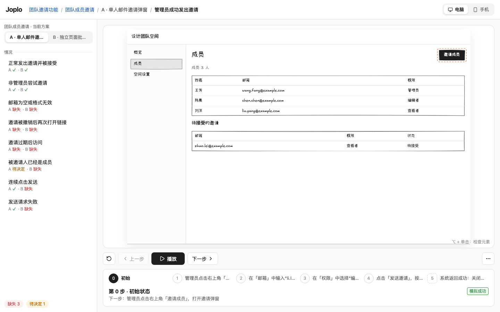
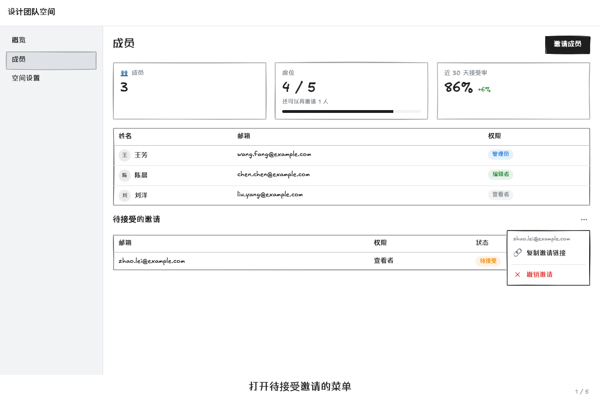

# Joplo 看板与发布站

在作者项目内启动：

```sh
npx joplo dev --open
```

看板只监听本机，默认端口 4790。同一 `JOPLO_HOME` 下一个进程服务多个项目；其他目录再次运行 `npx joplo dev` 会注册项目并返回已有看板链接。参数见 [CLI 文档](cli.md)。

## 首页与项目

左栏按最近打开排序列出项目名和缩写的目录（编译出错写错误数，目录不存在写“找不到”），↑↓ 切换；底部是“添加项目：在项目目录里运行 npx joplo dev”。右侧是所选项目的名字、说明、目录、“N 个功能 · 已选定 a / n”和编译状态；功能卡片整张可点（Enter 也可以），打开选定方案的演示（没有选定时打开第一个方案），卡片上有缩略图（选定方案第一个场景的初始画面，用这个项目的外观，进入视口才渲染）、选定方案、方案数和覆盖小结。首次打开显示标志和三条可复制的开始命令。

左栏最底下是 **Joplo Cloud 账号卡片**（D85，原型 `examples/joplo` 的 cloud_usage 方案 A）：套餐（免费版 / Pro）、邮箱、空间（已用 / 上限，例如 38.1 MB / 100 MB）与朗读剩余字数（免费写“剩 3,200 字（体验额度）”，Pro 写“本月剩 N 字 · 12月1日 重置”，加油包算在剩余里），“用量与音色 ↗”在新标签页打开 `<server>/usage`。没登录时写一句说明和可复制的 `npx joplo login`；已登录但云端连不上（或旧云端没有这些数字）时只写“暂时连不上 Joplo Cloud”，不显示数字；旧 CLI 启动的看板没有这张卡片。数据来自 `GET /__joplo/cloud/account`（CLI 的 `cloudBridge.account()`：`/api/v1/me` 的 storage 与 `/api/v1/voice` 的 quota）。

项目记录保存在 `~/.joplo/projects.json`。目录移动后可从列表移除失效记录，再从新目录打开；移除记录不删除项目文件。某个项目编译失败不影响其他项目，首页和演示页显示文件定位及说明；有上次成功结果时继续展示，修复保存后自动更新。

顶栏的「外观」（或按 `T`）打开外观浮层，配色、字体、线条分开选：首页改所有项目的默认，演示页只改当前项目。选择保存在本机 settings.json，不改作者 config；发布站只使用 config 的主题，不支持字体和线条。旧的 `#/settings` 链接会跳到首页并打开外观浮层。九个内置主题、选择优先级和完整变量见[主题文档](themes.md)。

## 演示页

本地看板的演示右侧有「反馈与评审」图标。它打开覆盖在画面上方的浮层，不挤压舞台；可填写真实反馈，也可直接「确认方案，结束评审」。浮层在全屏下也可使用。反馈带上打开时的页面、场景、步骤与源码位置；切页、收起浮层或发送失败都保留草稿。方案更新时保留旧草稿，明确选择「使用当前页面和版本」后再提交。

反馈图标可在演示区域内拖动，位置在当前浏览器中记忆；窗口大小和全屏状态变化时仍保持可见。拖动不会触发打开浮层，单击仍正常打开。键盘聚焦图标后，可用方向键微调位置，Shift + 方向键移动更大距离。

反馈先存到项目 `.joplo/reviews/`，Agent 通过 `joplo feedback watch --local` 读取。浮层显示是否有正在监听的 CLI，并可复制跟住整个项目的监听命令（`--local --follow`）。确认后本轮只读；源码更新后的新版本不会继承旧确认。此入口只在本地看板出现，不进入发布站或导出画面。

| 区域 | 用法 |
| --- | --- |
| 顶栏 | 品牌回到首页；「项目 ▾」「功能 ▾」下拉切换项目和功能（带缺口数）；「检查」开关（⌥）、「外观」（T）、「导出 ▾」、全屏（F） |
| 左栏 | 顶部是功能目标（goal）和“面向：角色”（feature.roles 的名字，D67）；方案行（字母、名字、已选定、缺失 / 待决定），点一下切换方案、情况保持；情况行显示当前方案的状态图标和其他方案的小标（悬停写“B：缺失”，点一下切到 B 看同一个情况），高优先级的情况带「!」；悬停方案或情况弹出卡片，情况卡片先写“期望结果”（case.expected，PM 的 Then；没写时提示“还没写期望结果”）；底部缺口汇总写缺失 / 高优先级 / 待决定，点一下复制 `npx joplo check --work <方案>` |
| 舞台框 | 画面和字幕合成一体；有层级时，层级标签贴在舞台框上沿，每个带预设图标，导演所在层右上角有摄像机角标；放不下时像书签一样压窄、叠起，悬停展开全名（D60）。右侧是「只重放这一层」和「跟随导演」开关 |
| 字幕区 | 画面下方居中显示本步说明与 explain；有角色时用户操作前是说话人（头像 + 名字），系统事件前是一个舞台高亮色的小圆点、说明用次级色；右下角是弱化的“n / m”，场景完成后换成结果标记，分叉标签在右侧；字体与颜色跟随舞台外观（D61） |
| 播放坞 | 回到开头（Home）、上一步（←）、播放 / 暂停（空格）、下一步（→）；时间线（当前步展开写说明，其余只有序号，悬停看说明，点一格跳到那一步）；速度 ▾；缩放 − 适应 + |

宽度不够时按顺序收起，控件位置不变、文字不换行，收起后的按钮在悬停提示里写全名和快捷键：

| 宽度 | 收起 |
| --- | --- |
| < 1440（如 1280×800） | 顶栏「检查 / 外观 / 导出」只剩图标；左栏 240，情况标题最多两行；当前步宽 200；缩放只剩 − + |
| < 1100 | 左栏收成 56px 竖条（方案只剩字母、情况只剩状态图标）；点竖条或按 `[` 浮出完整左栏，选完自动收回 |
| < 900 | 时间线只剩“当前步 / 总数”，点一下弹出全部步骤；字幕的 explain 收进悬停 |

任何宽度下页面都不滚动；时间线放不下时在自己一行里横向滚动。菜单、外观浮层、悬停卡片和快捷键面板都浮在页面上方，不压缩布局。

演示中的状态：

- 自动播放时，时间线的当前步从左往右填深黄，表示离下一步还有多久；暂停时停住，按钮变为「继续」。
- 上一步 / 下一步像视频的快退 / 快进：播放中按了**接着播**——下一步在动画进行中 = 立即完成这一步并停留，在停留中 = 跳过剩余停留开始下一步，最后一步停留中 = 播完（不从头重播）；上一步退回一步，在那一步停留（并朗读）后继续往下。暂停或没在播放时只走一步，不开始播放。
- 点了画面里不是这一步的东西：画面顶部居中一条轻提示，目标闪一下，3 秒后消失。三种写法：“按当前场景，下一步是：…”（带「回到演示」）、“当前演示没有覆盖这个操作”、“现在不可用：原因”。
- 场景完成后，字幕区右侧给「重新播放」和「下一个情况：… →」（左栏顺序里当前方案已表达的下一个情况，没有就不显示；`Enter` 也可以）。
- 编译出错时，舞台上沿出现红边横幅：错误数和第一条 `文件:行`，可展开；画面继续显示上一次成功的结果，修好保存后横幅自动消失。
- 标签页标题是“功能 · 项目”；编译出错时标题加 ✕、favicon 右下角加红点；导出视频时标题写“导出中 3/5”、favicon 加黄点。
- 按 `?` 打开快捷键面板。

没有覆盖当前情况时，画面上方是缺口横幅：说明这是缺口、不是演示，画面先静态显示这个方案的页面；「复制给 Agent 的话」复制一句补场景的请求（含 `npx joplo check --work <方案>`）；有其他方案已经表达了这个情况时，「看方案 X 怎么处理」直接切过去。没有方案或场景时显示相应空状态。

画面、字幕和控制在一屏内呈现。电脑页铺满可用区域；手机页固定 390 宽并使用 Phone 外框，按比例放在暖灰底上；检查模式下看板在画面左上角标注“手机页面 · 390 宽 · 外框由画面自动加上”（平时不显示，D61）。舞台上不显示作者提示：⌥ 单击检查元素的说明在顶栏「检查」按钮的悬停提示里。每个页面的 viewport 决定设备；手机版需要单独设计页面或演示。

全屏（`F`，`Esc` 退出）只留画面、字幕和底部居中的深色控制胶囊（上一步 · 播放 · 下一步 │ 速度 │ 外观 │ 退出），宽屏时右侧写常用快捷键；鼠标静止约 2.5 秒后胶囊淡出，空间保留，画面不跳动。



## 层级、导演与镜头

在方案里用 `layers` 和 `layer(title, tree)` 声明独立页面。各层共享场景状态，切层不改变步骤；需要全景时显式声明一层。

`routes` / `on` 可以和 `layers` 同时用，但方案声明了层级后，演示舞台只显示这些层，路径页面不再画出来；路径仍提供 flow 的起点和 `go()` / `back()` 的状态，步骤目标先在各层里找（找不到再看路径页面）。想让路径页面也出现，就把同一个组件再放进一层。

步骤中的 `shot(...ids)` 指向组件、卡片、按钮或图表元素。第一个镜头所在层决定导演层，`shot()` 回到整层。导演按步骤切层、平移缩放并高亮焦点，取景时保留目标所在的分组或容器（见下一节）。

- 正在看的那层总是与舞台框连成一片；导演跟随时它带摄像机图标，并随步骤自动换（D55，取代“导演跟随时不高亮”）。
- 点某一层后停在这层（摄像机消失、「跟随导演」关闭），步骤不变；深链接带 `l=<层>` 时同样固定在这层。固定后后面的步骤不再自动切层，即使镜头或操作目标在别的层（那一层的镜头照常记着，只是看不到）；打开「跟随导演」或去掉 `l=` 后回到流程镜头。
- 「只重放这一层」从第 0 步播放，只使用这层的镜头，无变化的步骤快速带过。
- 滚轮、捏合与播放坞里的「− / +」缩放，拖动平移，「适应」恢复镜头的画面。
- 导演跟随时的自由缩放维持到下一步；手动层的视图保持到换层或适应画面。

## 关系类图表、trace 与字幕

三种图表讲后端、架构和逻辑（D69，调研与取舍见 [diagram-layout.md](research/diagram-layout.md)）：

- `Diagram`（`Diagram.Group` / `Diagram.Node` / `Diagram.Edge`）：什么和什么相连，按业务域分组。分组有标题、图标（`icon`）、色调（`tone`），可以嵌套，也可以用 `group="分组 id"` 归组；连线可以连到分组。
- `Sequence`（`Sequence.Actor` / `Sequence.Message` / `Sequence.Group` / `Sequence.Block`）：一次调用按时间先后，参与者成列、消息成行并编号，片段（alt / opt / loop / par…）框住若干行。
- `StateMachine`（`StateMachine.State` / `StateMachine.Transition` / `StateMachine.Group`）：实体的生命周期，`value` 绑定当前状态；某一步改了这个值，对应的转换自动点亮。

布局在编译期由 ELK（分层、少交叉、正交走线、分组内外一起布局）算好，写进 IR；不写 `direction` 时按舞台比例在左→右、上→下里选字最大的一种，次要（async）连线可以不参与分层，让业务域并排；时序图的布局是纯函数。看板与发布站只读坐标，不带布局算法，也不发请求。一张图的坐标只由结构决定：同一个场景的所有步骤里每个节点的位置完全相同，`when` 隐藏的元素也提前占好位置；新增或消失的元素淡入淡出，其余不动。作者不写坐标，只用源码顺序（同层顺序）和 `pin="start" | "end"` 给少量提示。

用 `trace('a', 'b', 'c')` 表达调用链，节点 / 连线（以及它们所在的分组）的 active、ok、error、dim 状态自动推算；每一步只有本步的调用线加粗、着色、带流动的小点，其余连线变细变浅；失败用 `trace.fail()`，跳过用 `trace.skip()`，无需手写状态效果。时序图里 trace 消息 id，一行一行地讲。

trace 同时提供镜头目标。取景保留上下文：镜头对准图表里的节点时，画面里至少有它的父分组标题，放得下就是整个父分组；多个节点时容纳全部节点和各自分组的标题；时序图的一行带上两端参与者的头部。对准界面元素（卡片、按钮）时保留它所在的有框容器，推近不超过 1.25 倍。节点不会因为镜头而移动（D69 取代 D47 的聚焦布局）。完整示例见 [agent-arch](../examples/agent-arch)，写法运行 `npx joplo skill diagram`。

字幕放在画面下方，说明用大字，explain 用较小文字，不遮挡原型。说明建议 24 字以内、explain 建议 48 字以内，英文按半个字算；超出时 check 给 CAPTION_TOO_LONG / EXPLAIN_TOO_LONG 警告。一步只讲一件事，长说明放在独立说明层再切过去讲。

自动播放的阅读时间按中文每秒 8 字（125ms/字）、拉丁文字每秒 15 个非空白字符计算，先限制在 3–7 秒，再按 0.5× / 1× / 1.5× 缩放。7 秒只限制阅读部分，不截断流式输出、镜头和连线动画的等待；镜头统一使用 700ms、急起缓停且不回弹的 ease-out。字幕显示当前播放或刚执行的步骤。第 0 步是场景封面（D61）：盖在第 0 步画面的模糊淡影上，写所属功能 · 方案、flow 的标题与 description（没写 description 时用功能目标 goal，D67：封面默认就说清“解决什么”）、「约 N 步 · 约 M 秒」（逐步按上面的停留时间估算）和出场角色；点「开始」或按空格从头播放。导出图片和分享预览的第 0 步就是封面；`joplo render` 的单张截图仍是第 0 步的真实画面。过渡卡与封面铺满舞台区域，不进手机外框。过渡卡那一步舞台不可操作（inert），点不到画面上的元素；按「下一步」（或 → 键）或自动播放继续。

## 产品界面组件（D68）

常见产品画面不必再用 Box / Paper 手拼（属性与示例：`npx joplo components <名字>`）：

- `EmptyState`：空列表、404 / 过期 / 无权限页、结果页；图标圈、标题、说明，操作按钮放子节点。
- `ListRow`：头像或图标 + 标题 + 副标题，右侧内容放子节点；`active` 时浅色底。可点的整行仍用 NavLink。
- `Menu`（Target / Dropdown / Item / Label / Divider）：`opened` 写在 Menu 上（编译器抄给 Menu.Dropdown，门控与 Modal 一致，菜单关着时点菜单项回放报 TARGET_HIDDEN）；下拉浮到弹窗层，跟镜头一起缩放，不被表格或卡片裁掉；`position` 为 bottom-start / bottom-end / top-start / top-end。
- `TabBar`：手机底部标签栏，`data: [{ value, label, icon, badge }]`，`.select('tabs', 'me')` 切换；放在全高 Stack 的最后，贴住底部。
- `Stat`（指标卡，diff 以 + 开头绿、- 开头红）、`KeyValue`（名称 …… 值，`total` 时最后一行加粗）、`BarChart` / `LineChart`（data / dataKey / series，低保真 SVG，set 新数组时柱子和折线动画过渡）、`Avatar.Group`、`Radio.Card`（放在 Radio.Group 里，select 选中）。
- 已有组件补齐：`Notification` 加 `position`（top / top-left / top-right / bottom / bottom-left / bottom-right，浮在当前页面上，用 when 控制出现）与 `icon`；`DataTable` 的列加 `badge`（值 → 颜色）、`avatar`、`sortable`，表格加 `sortStatus`（只画箭头）、`selectedRecords` + `idAccessor`（勾选列与选中行底色）、`fetching`（加载遮罩）；`Tabs.Tab` 的 `rightSection` 计数；`Skeleton` 加载时呼吸（截图与导出静止）；`Indicator` 的 `disabled`（可以是条件）现在真的会隐藏角标。
- 状态全部来自绑定的属性与输入值，由步骤驱动；跳到哪一步就渲染哪一步。渲染器不发网络请求、不加载外部资源：发布站在与云端相同的 CSP（`connect-src 'none'`）下用真实 Chromium 验证过（packages/server/test/product-ui-csp.test.ts）。

样板见 [examples/invite](../examples/invite)（“撤销邀请后对方再打开链接”）；截图见 [screenshots/story-ux](screenshots/story-ux/)。



## 故事表达（D56 P1）

- 步骤效果 `fork('如果阿杰去不了', 'cant_go')` 在本步字幕右侧显示路线标签，点击切到同方案目标场景并跳过相同动作与业务效果的公共前缀。时间线显示分叉图标和标签；自动播放继续主线。
- `mark('share', { kind: 'arrow', note: '生成完才能分享' })` 本步画手绘圈注/箭头，下步消失。kind 支持 circle（默认）、underline、box、arrow。图形跟随镜头和内容变化；目标隐藏、在别层或画面外时不画。
- `<Email from="营地助手" to="阿杰" subject="行程有更新" time="周五 20:05">正文</Email>` 是简单邮件卡片，自身不可操作，正文可含 Button。
- 数据放在单独 `layer`，用 `shot` 切过去：`<DataCard title="行程" value={$.data.trip} fields={[{ key: 'date', label: '日期' }]}/>`；fields 缺省展示全部键，空数组不展示行。
- `<StateFlow value={$.data.trip.status} states={['draft', 'shared', 'confirmed']} labels={{ draft: '草稿', shared: '已分享', confirmed: '已确认' }}/>` 按顺序显示已完成、当前与待完成状态。未知值不高亮任何状态。
- DataCard 与 StateFlow 只突出本步的变化，并显示旧值 → 新值；跳转与逐步播放一致，下一步未变化时恢复普通样式。
- `.press('⌘K')` / `.press('Enter', ...效果)` 是无目标用户步骤，自动字幕为「按下 ⌘K」。舞台底部的按键记录显示键帽；type 播放时逐字显示已有预览。静态只显示刚执行的一步，其他步骤清空，不累积历史。按键记录避开 Toast；角色不再以名牌显示在舞台上，改为字幕里的说话人。

完整示例见 [camping](../examples/camping)。新增字段属于演示内容，发布站保留；源码位置与创作信息仍去掉。

## 焦点与呈现形式（D70）

演示是一段叙事：每一步观众该看哪里（焦点对象），用什么形式看（呈现形式）。焦点由 core 的 `focusAt(project, 场景, 位置)` 推导，是步骤的纯函数：看板、发布站（含嵌入、评审模式）、`joplo render` 截图和视频导出读同一份，跳到任意一步、前后翻、回放结果相同。

默认（不写任何代码）：

| 这一步 | 焦点 | 呈现 |
| --- | --- | --- |
| 第 0 步 | 场景封面 | 封面（D61） |
| 过渡卡 | 卡片本身 | 幕布 |
| 用户操作 | 被操作的元素 | 鼠标移过去、点击波纹；目标不在画面里时镜头把它带进来（原有行为） |
| 写了 trace | 调用经过的节点（时序图是消息那一行） | 镜头，按 D69 取景带上父分组（原有行为） |
| 系统步骤或操作之后有元素新出现、内容变化 | 这些元素 | **结果揭晓**：外沿亮一下再淡出（约 1.6 秒），不移动镜头、不压暗；图表元素不画（图表自己有淡入与点亮） |
| 导演换到另一层且这一层要推近 | 新画面 | **先全景再推近**：新画面淡入时停在整层，0.4 秒后推近到焦点 |

结果揭晓是克制的：弹窗、抽屉（自带遮罩）不提示；DataCard / StateFlow 自己会突出变化，不重复；一次变化超过 3 处不提示；换页、换层不提示；同一个元素连续变化、往同一个容器里连续追加（终端、聊天记录一行行出现）只在第一次提示；这一步作者写了任何焦点（shot、trace、mark 或下面的提示）时不加默认提示。静态截图（`joplo render`）、减少动态效果时不画揭晓，也不做先全景再推近。`config({ autoFocus: false })` 整体关掉这两项默认行为，作者写的照常。

作者可选的呈现形式（只作用于这一步，跟随舞台主题，手绘主题是手绘描边）：

| 写法 | 用途 | 画面 |
| --- | --- | --- |
| `shot('id', …)` | 细节太小、要看清 | 镜头推近，焦点外调暗（原有） |
| `spotlight('id', …)` | 一屏信息很多，此刻只看这一块 | 不推近；其余区域用背景色冲淡，洞口外沿一圈强调框 |
| `highlight('id', …)` | 这里变了 / 这里是关键 | 不推近；强调框，出现时脉冲一次 |
| `callout('id', '一句话', { side })` | 为什么在这里（便签式说明） | 浅强调色便签 + 引线；side 不写时按 右 → 左 → 下 → 上 选放得下、不压住目标和其他提示的一侧 |
| `numbered('a', 'b', 'c')` | 这一屏由几部分组成、先后顺序 | 目标左上角编号 1、2、3，外沿细框 |
| `hold(秒)` | 给观众时间看（图表、对比、大段结果） | 自动播放至少停这么久（0.5–30 秒，按速度缩放）；封面、outline 与 check 的估算时长同样计入 |
| `<Code redact>` / `redact={not($.ui.revealed)}` | 密钥、隐私信息 | 内容模糊、布局不变；条件为假时清晰；图表连线及其独立标签同步模糊 |

- 提示不推近镜头。目标不在当前镜头里时，编译器给这一步补一个整层镜头（写进 IR 的 shots），之后的步骤沿用整层；这一步自己写了这一层的 shot 时以 shot 为准。没有 shot 的步骤，第一个提示目标所在的层决定导演切到哪层。
- 提示层整层 `pointer-events: none`，不改变可点击区域；聚光的洞口同时让出下一步要点的元素。
- 与图表取景（D69）的组合：**焦点决定看哪个对象，D69 的取景规则决定框多大，先全景再推近只改变镜头怎么到达**。
  - trace 的焦点对象与镜头目标相同：架构图 / 状态机是路径上的节点，时序图是消息那一行（不是参与者）。
  - 取景一定带上的归属信息算“在镜头里”：镜头目标的最内层父分组、时序图消息两端的参与者。提示指向它们时不补整层镜头、不报 FOCUS_CONFLICT；同一分组里镜头外的兄弟节点不算（取景可能只带分组标题，兄弟节点也会被调暗）。
  - 聚光图表元素时，洞口同时留出它的父分组标题（时序图消息留出两端参与者的头部），压暗不会把“属于哪里”冲掉。
  - 图表自己呈现变化（新元素淡入、连线沿路径画出、trace 与状态机 value 点亮），默认的结果揭晓不再叠加在图表元素上。
  - 提示与先全景再推近都画在镜头容器里，不改图表的 DOM 与坐标：同一场景每一步的节点位置仍然相同（D69 不变量 1）。
- 目标隐藏、不在当前显示的层、测量不到时不画（与 mark 相同）。
- check：目标不存在报 FOCUS_UNKNOWN（error）；提示 / 标注的目标不在这一步导演所在的层报 FOCUS_OFF_LAYER，提示指向这一步 shot 之外报 FOCUS_CONFLICT，气泡超过 24 字报 CALLOUT_TOO_LONG（warning）；连续 3 个系统步骤画面上没有任何变化报 FOCUS_IDLE（info）。在 `examples/` 与官网 4 个示例上新提示均为 0 条（集成 0.2.8 后复测相同）。
- IR：`Step.cues`（spotlight / highlight / number）、`Step.callouts`、`Step.hold`（毫秒）、`SceneNode.redact`、`Project.autoFocus`，都只在用到时出现，不用新功能的项目编译结果不变；发布站、评审版保留。旧的发布产物没有这些字段时照常播放。

写法建议与反例见 `npx joplo skill focus`；样板见 [camping](../examples/camping)（开场编号建立上下文、结论聚光加便签、生成完才能分享的便签、阿杰手机上的结果揭晓），前后对比截图见 [screenshots/narrative-focus](screenshots/narrative-focus/)。

## 朗读（D74）

自动播放和「下一步」时把每一步读出来；播放中按上一步，退回的那一步也会读（接着播）；没在播放时的跳转、上一步和热更新不读。

- **读什么、谁来读**：`narrate('…')`（旁白的声音）> `say('…')`（这一步角色的声音，没有角色时用旁白）> 字幕（旁白的声音；过渡卡读标题和副标题）。explain 不读。写法见 `npx joplo skill story` 第 6 节。
- **节奏**：每一步停留 = max(画面停留, 声音读完 + 0.45 秒换气)。画面停够了、声音没读完时不切走，字幕区左侧的胶囊从“正在朗读”变成“等旁白读完”。暂停时声音一起暂停；上一步、下一步、切场景立刻停掉当前声音（播放中跳步后从新的一步接着读）。倍速时声音一起变速。
- **声音来源**（D85：只有官方的）：播放坞的 🔊 按钮打开浮层：开关（看板默认关，记在本机 `localStorage` 的 `joplo.voice.on`）、声音来源、旁白音色与试听、生成音频、管理密钥。来源依次是：
  - **Joplo Cloud 朗读**（排第一，标“推荐”）：登录即用、不用配 Key（用 CLI 的登录，或 `JOPLO_API_KEY`，Key 需要 `voice:generate` 权限）；右边写“剩 N 字”，没登录写“登录后可用”（选它时给可复制的登录命令，先用浏览器朗读），云端连不上写“暂时连不上”，旧 CLI 启动的看板写“需要重启 joplo dev”。
  - **浏览器朗读**（本机，零配置）。
  - **OpenAI**、**ElevenLabs**：官方接口，地址固定不可改，自带 Key；没有 Key 时写“没有密钥”。Key 在「管理密钥…」里粘贴、测试（试读一句）、保存或删除，也可以用环境变量 `OPENAI_API_KEY` / `ELEVENLABS_API_KEY`；存在 `<JOPLO_HOME>/voice/profiles.json`（权限 0600，所有项目共用），接口只回是否已保存与末 4 位，Key 不进项目、不进产物。
  - 以前的 AiHubMix 预设、可改 Base URL 的 OpenAI 兼容和自定义 HTTP 已去掉，不再读 `AIHUBMIX_API_KEY`。本机还留着的这类 profile 列在最后、标“不再支持”（包括旧版把 OpenAI / ElevenLabs 预设改成别的地址、请求头或返回格式的——它原来的 Key 是给代理的，绝不会发到官方地址，删掉它才恢复官方预设；以及旧版自建、id 恰好是 `cloud` 的 profile，改名为 `cloud-old` 保留）：声音指纹不变，已生成的音频照常播放、照常随 build / share 带上，但不能再生成（浮层不给生成按钮，`joplo voice` 报 `VOICE_UNSUPPORTED`）；「管理密钥」里可以删掉它们。
  - **默认**：项目没选过来源、`joplo.config.ts` 也没写 `voice.profile` 时，已登录就用 Joplo Cloud 朗读（看板、`joplo build`、`share`、`joplo voice` 同一规则），没登录用浏览器朗读；在浮层里选过「浏览器朗读」就一直是浏览器朗读（`.joplo/voice/index.json` 的 `chosen: true`）。`voice.profile` 写了时以它为准，浮层里只读。
- **旁白音色与试听**：浮层写“旁白：<音色名>”，Joplo Cloud 的音色名按内容语言（没有时界面语言）显示；「▶ 试听」播放云端预先生成的样音（不扣字数，免费账号也能听），「换音色」列出全部音色（每个都能试听），选中后存为这台电脑上这个来源的默认音色；config 的 `voice.narrator` / `voice.roles` / `voice.locales` 仍然优先。Joplo Cloud 的 6 个音色都能读 10 种界面语言；内容多语言（D84）时非默认语言用云端给的这种语言的推荐音色（音色在推荐里就不换，否则同性别优先）。这种语言第一次生成成功时，选中的音色记进项目 `.joplo/voice/index.json` 的 `pins`（语言 → 基础音色 → 选中的音色），之后 build、share、播放和 `joplo voice` 都按它选——云端调了推荐、或换一台电脑没有音色表缓存时，音色和指纹也不变，旧音频不会失效、不会重新扣字；只有这种语言从没生成过时才按推荐挑。OpenAI / ElevenLabs 保持原来的预设音色（性别、口音按界面语言显示，推荐的与同语言口音的排前面）；看板从朗读文字识别旁白语言（假名 → 日语、谚文 → 韩语、汉字 → 中文，否则界面语言），OpenAI 的默认说话风格要求用文字本身的语言和母语口音读，ElevenLabs 的口音由音色决定。
- **字数与额度**（Joplo Cloud）：按钮写“生成缺少的音频（N 步 · 约 X 字）”——X 是缺音频的片段文字长度之和（`Array.from` 计字，同一段只算一次，与云端扣费一致）；下面写“生成后还剩 Y 字”（Y = 剩余 − X）。剩余字数来自云端：每生成一段，服务端用响应头 `X-Joplo-Chars-Remaining` 更新并推送，看板不在本地估算；打开浮层时重新问一次云端（看板进程内缓存 60 秒）。**Joplo Cloud 朗读只在点按钮（或运行 `joplo voice`）时请求云端**：播放时不现场生成、也不预取后面几步（会花用户的字数），只用已生成的音频，缺音频的步骤用浏览器朗读，字幕区的“正在朗读”胶囊旁标“浏览器朗读”。X 超过剩余时照常给按钮，同时提示“额度不够”、用完会停；生成中收到 402 时停下：已生成的保留，浮层显示“朗读额度不够”、还有几步约多少字、剩多少，以及「买加油包 ↗」（`<server>/usage`），不再显示生成按钮；边放边生成也不再请求，没有音频的步骤用浏览器朗读，字幕区的“正在朗读”胶囊旁标“浏览器朗读”。503 / 429 / 网络错误按 CLI 的重试策略重试，仍失败的步骤记进失败原因，下次只重试它们。云端连不上、或旧云端没有朗读（`/api/v1/voice` 404）时：已登录仍按 Joplo Cloud 的指纹找已生成的音频（离线也能播），但生成按钮不可用、不请求云端，浮层写“暂时连不上 Joplo Cloud。没有音频的步骤用浏览器朗读，稍后再试。”；生成接口直接返回 `TTS_UNAVAILABLE`，旧云端的 404 也算“停下、不记成步骤失败”。
- **生成与缓存**：音频按 `clipKey(声音指纹, 朗读文字)` 缓存在项目 `.joplo/voice/clips/<sha256>.<ext>`，索引在 `.joplo/voice/index.json`（看板选用的 profile、每段的步骤、文字、语言，以及失败原因）。声音指纹：Joplo Cloud 只看音色（云端换上游模型不让旧音频失效）；其他来源包含接口、地址、模型、音色、返回格式、请求体模板与说话风格，不含 Key；改了字或换了声音就是新键，旧音频自然不用。「生成音频」一次生成当前方案的所有场景；**边放边生成**（只有 OpenAI / ElevenLabs，用户自己的 Key）：播到还没有音频的一步当场生成这一段，同时预取后面 3 步，最多等 10 秒，超时先用浏览器朗读。没有音频、加载失败时都改用浏览器朗读，不静音、不卡住。
- **发布站与嵌入**：`joplo build` 把当前声音已生成的音频拷进站点 `voice/`，IR 带上 `voiceIndex`（声音指纹与片段地址）；发布站和嵌入在带了音频时朗读默认开（观众可点 🔊 关掉；没有音频时默认关，点 🔊 才用浏览器朗读；浏览器在观众按播放前拒绝出声时跳过这一段，播放照常进行；PR 差异的同步播放始终静音），用 `<audio>` 播放同一站点的文件（分享页 `connect-src 'none'` 下也能用），没有音频的步骤用观众浏览器朗读。
- **终端**：`npx joplo voice [dir]` 与看板的「生成缺少的音频」同一套缓存与规则（选定方案的所有场景、每种内容语言），`--dry-run` 只估算，见 [CLI 文档](cli.md#voice)。
- **接口**（都要本机令牌）：`GET/PUT/DELETE /__joplo/voice/profiles[/:id]`（PUT 只能改预设的默认音色与 Key）、`POST /__joplo/voice/test`（OpenAI / ElevenLabs 的 Key）、`GET /__joplo/p/:id/voice[?refresh=1]`（状态里有 `cloud`：是否登录、额度、用量页、是否收到过 402）、`PUT /__joplo/p/:id/voice`、`POST /__joplo/p/:id/voice/generate`、`POST /__joplo/p/:id/voice/clip`（Joplo Cloud 朗读返回 409 `CLOUD_GENERATE_ONLY`）、`GET /__joplo/p/:id/voice/clips/:file`；状态变化推 HMR 事件 `joplo:voice`。实现见 `packages/server/src/voice.ts`、`voice-http.ts`，网页 `runtime/voice.ts`、`board/Voice.tsx`、`player/SiteVoice.tsx`，纯函数 `core/src/voice.ts`。
- **重新发布沿用音频**：项目没选过来源（默认来源，例如登录后默认 Joplo Cloud）、又有上一次的分享时（`share` 更新同一个链接、`share --update`），逐片段优先带上本机按当前默认来源生成的有效音频，再按上次分享中相同文字的实际指纹补齐；新增语言、换了默认音色或新旧来源不同也能共存，发布索引按语言、角色与文字记录实际声音，后续换电脑更新仍能沿用。在看板或 config 里明确选过来源时按选的来源，不再继承旧来源。
- **旧来源的 cloud 名称冲突**：旧版自建、id 为 `cloud` 的来源会以 `cloud-old`（重名时加序号）显示为“不再支持”，旧的看板选择和 `voice.profile: 'cloud'` 继续使用其原指纹，已生成音频仍可播放、发布。主动在看板选「Joplo Cloud 朗读」会持久记住官方选择；若来源由 config 控制，将 `voice.profile` 改为明确的官方名称 `'Joplo Cloud'`。切换前不会用官方 cloud 代替旧来源生成，也不会转用旧 Key。
- **自动字幕音频有效性**：改过按钮名、输入/选择值或按键后，build/share 会按当前自动字幕参数与每段缓存的语言重新计算文字，只打包仍然匹配且缓存键一致的音频，再按本机与旧分享的优先级选声音。无法验证的语言或旧文本不进入站点文件和播放索引；没有有效片段时计入缺失并退回浏览器朗读，其他语言仍有效的音频继续保留。
- **音色记录恢复**：`pins` 逐层校验语言、映射与六种固定音色 ID；损坏项单独忽略，保留合法项，缺失项按推荐规则选择并在成功生成后记下。无需删除整个 `.joplo/voice/index.json`，其中还保存已有音频的索引。
- **已知限制**：视频导出还不带声音（第二期）；看板外观不发布；角色的音色只能在 `joplo.config.ts` 的 `voice.roles` 里写；观众切到别的语言时，自动字幕那几步用浏览器朗读。

## 全屏与快捷键

画面右上角按钮或 F 进入/切换全屏。全屏保留画面、字幕与下方播放控制，其他导航隐藏；鼠标静止约 2.5 秒后控制条淡出，移动后恢复，内容尺寸不跳动。

| 按键 | 行为 |
| --- | --- |
| F | 切换全屏 |
| 空格 | 播放/暂停 |
| ← / → | 上一步/下一步（播放中跳一步后接着播，暂停时保持暂停） |
| Esc | 退出全屏 |

编辑输入框时不会把 F 当作全屏命令；按住修饰键也不触发 F。全屏状态不写入链接。发布站提供同样的全屏交互。

## 选中与源码定位

单击按演示流程操作；打开顶栏的「检查」开关后单击（或者随时按住 ⌥（Option/Alt）单击）检查元素，不执行步骤：悬停的元素先画墨色虚线框，左上角写“类型 · 名字”；单击选中后右侧浮出抽屉（没有遮罩，可以接着点别的元素，Esc 关闭），显示标签、规则、情况、备注和文件定位。随后让 Agent 运行 `npx joplo selection`，读取源码片段，只改选中的位置。

定位链路：kit jsxDEV/callsite → compile 的相对 source → DOM 的 data-jat → 服务端校验选中并计算 at → 项目 `.joplo/selection.json` → CLI 输出源码。选中写入原子完成，文件不提交 Git。

取消选中时保存 null。对象因热更新被删除或校验失效时会清除选中；行号变化时重新计算定位。网络或令牌失败时界面回滚到上一次确认的选中。源码位置只在本地创作侧提供。

## 导出

顶栏「导出 ▾」可发布到 Joplo Cloud、导出当前步骤图片、录制整个场景视频、复制当前步骤链接、在编辑器中打开源码。导出使用当前保存的外观（配色、字体、线条）。

- **图片**：导出 PNG，页面设备和导演镜头由当前步骤决定，包含字幕；本地由导出组件（Playwright + Chromium）渲染。
- **视频**：本地用导出组件录制整个场景为 WebM，保存到项目 exports/，同一项目同时只运行一个视频任务。点菜单项直接开始；「导出」按钮上出现进度环，重新打开菜单可以看到“正在录制第 3 / 5 步”和「取消」（关掉菜单不会中断）；完成后轻提示写文件位置并可“再导出一次”，失败时说明原因并可重试。
- **导出组件（D66）**：图片和视频导出需要的 Playwright + Chromium 由 Joplo 装在 `~/.joplo/runtime/` 下（与 `npx joplo setup export` 是同一份），不写项目文件；普通看板、写演示、check、build、share 都不需要它。项目里已经装了 playwright 的老项目直接用项目里的那份。
  - 没装时「导出 ▾」菜单顶部是安装卡：说明（约 100 MB 下载，一台电脑装一次，不装进项目）、「安装导出组件（约 100 MB）」按钮和终端命令。只有点这个按钮（或点导出后轻提示里的「安装并导出」）才开始下载，导出本身从不自动下载。
  - 安装中：卡片显示阶段（安装 Playwright → 下载 Chromium（N MB）→ 检查 Chromium 能否启动）和进度条，「导出」按钮上是同一个进度环；关掉菜单不会中断，其他看板页面也能看到同一个任务。
  - 装好后轻提示“导出组件已安装”，并继续刚才点的导出（图片或视频）；失败时卡片和轻提示写明原因（例如网络错误、npm 失败、Chromium 起不来），可以重试。
  - 接口：`GET /__joplo/p/<id>/export/runtime` 读状态；`POST /__joplo/export-runtime/install` 开始安装、`GET /__joplo/export-runtime/install/events`（SSE）推送进度。安装和进度流都要页面里的本机令牌（`x-joplo-token`），并校验 Host 与 Origin、要求 `application/json`，所以别的网页不能触发下载。
- **链接**：保留项目/功能/方案/情况/场景/步骤及手动层选择；全屏、检查模式、浮层开关不写入链接。
- **发布到 Joplo Cloud（D76）**：菜单最上面单独一项，蓝底白字，和下面的本地导出用分隔线隔开。点开是浮层（e1，盖在画面右上方，不挤压布局）：
  - 先读账号（`GET /__joplo/cloud/account`，本机令牌）。没登录时写明“发布需要一个免费的 Joplo 账号”，给出与 CLI 相同的登录命令（`npx joplo login`，非默认服务器时带 `--server <地址>`）和「复制命令」；在终端登录后点「我已登录，重新检查」继续，不用刷新页面，还没登录时提示先运行命令。
  - 已登录：写账号邮箱和套餐（免费版 / Pro）；下面是账号空间（C27，原型 `examples/joplo` 的 storage_quota 方案 B）：用量不到八成时只有一行小字“已用 38 MB / 100 MB · 链接永久有效”，八成以上出现黄色用量条与“空间快满了”（免费版给「管理我的分享」和「升级 Pro」，Pro 只给管理），这次放不下时用量条变红，并显示需要多少、还剩多少、已有链接不受影响和同样的入口；发布成功的结果里写“永久链接 · 这次 9.1 MB”。然后选范围——当前场景（默认）、当前功能、整个项目（D75），下面写明“只有选中的内容进入分享；其他功能不会上传，不只是隐藏”。点蓝色「发布」开始。
  - 发布中：检查项目 → 构建站点 → 上传 → 收尾，逐项打勾；关掉浮层不会中断，菜单项的第二行写“正在发布…”，再打开能看到同一个任务。同一项目同时只有一个发布任务。
  - 完成：链接（可点、复制、在新标签页打开）、有效期或“永久链接”；借用了别的功能的内容时列出每一项（功能名 › 元素 / 页面）并说明只带这些、怎么去掉；预览图跳过、朗读音频等提示原样列在下面。按钮变为「再发布一次」。
  - 失败：红框写错误（检查没过时带第一条错误的 `文件:行`）和「重试」；因为没登录或登录过期而失败时改为显示登录命令。
  - 发布走 CLI 的 `share()`（与 `joplo share --private --no-review --scenario / --work` 同一套检查、构建、上传和 `.joplo/cloud.json` 记录）。CLI 启动看板时把它注入看板进程；令牌只在本机进程里，页面只拿到邮箱和套餐。接口：`POST /__joplo/p/<id>/cloud/publish`（本机令牌 + Origin + JSON，body `{scenarios?, features?, visibility, review, password?}`，都为空 = 整个项目）开始，`GET` 同一路径读当前任务，进度推 `joplo:cloud`。旧版 CLI 启动的看板没有这个能力：菜单项第二行写“重启 joplo dev 后才能从看板发布”，浮层说明原因。


## 发布站

`npx joplo build` 生成纯静态目录（素材是 `assets/<sha256>.<ext>` 独立文件），用 `npx joplo preview` 在本机打开，或部署到任意静态托管服务；不支持 file:// 双击（D98）。

发布站字体按内容裁剪：在 source 与 npm dist 两种模式下，先完成 IR/入口 JS 内联和作者 CSS 编译，再扫描 staging 目录里全部 UTF-8 文本产物（含全部语言词典、HTML、CSS content 与 Unicode 转义），保留有交集的 Excalifont / 霞鹜漫黑 `@font-face` 和对应 woff2。无法解析的规则保守保留；许可证随实际分发字体保留。裁剪后的 CSS 重新计算文件名哈希并更新 HTML 引用，避免静态托管缓存旧规则。目录仍自包含，默认字体不引用外部 URL，不加载文楷，不带小赖。观众在输入框中新输入、且产物未出现过的字可能退回系统字体；罕用汉字与韩文也使用系统字体。

发布站与本地看板共用首页和演示页布局，只呈现选定方案、功能目标、角色、场景、步骤字幕及整体布局（首页卡片与左栏写“面向：角色”，D67；情况的期望结果与优先级是创作侧信息，不发布）。没有本机项目目录、缺口、待决问题、规则来源或源码检查抽屉。`joplo share --private --review` 构建的评审版（`buildSite({ review: true })`，D63）另含所有功能的所有方案，供云端评审页按场景切换比较；规则、问题、情况、AI 假设、备注、取舍和源位置同样不进产物。

层级、导演、只重放一层、缩放平移、播放速度、时间线、字幕、全屏和快捷键与看板一致；分享带了音频时朗读默认开，没有音频时默认关、点 🔊 打开（见[朗读](#朗读d74)）。带 `?embed=1` 时是给 iframe 用的嵌入模式，见[嵌入模式](#嵌入模式)；再加 `review=1` 是给云端评审页用的评审模式，见[评审模式](#评审模式embed1review1)。所有作品都有封面；多个条目的首页显示项目名、说明和作品卡片（带缩略图、切片数与时长）；按场景保密分享（D75，`joplo share --private --no-review --scenario / --work`）的产物里 IR 带 `scoped: true`，只有一个条目时打开先进入它的封面、不经过首页，产物里不带项目说明。只有一个条目时，面包屑上的条目不再是下拉。演示页的顶栏只有「复制链接」和全屏，左栏是功能名、目标和选定方案的场景（按场景排列，没有方案切换），底部标明“用 Joplo 制作的概念原型 · 非正式实现”。没有检查、外观和导出（D55）。发布站的配色固定用 config 的 theme，字体和线条暂不发布；作者 CSS 随产物打包。

### 水印（D83）

发布站默认在舞台右上角带一个半透明的小 Joplo 图标（`stage-watermark`，手机上看时更小），指向或聚焦时完全显示，点击在新标签页打开 joplo.app。它在过渡卡、封面之上，在提示之下；左上角的层级标签、右下角的完成操作和下一章卡片不受影响。页面里有 `<meta name="joplo-branding" content="off">` 时去掉（[branding.ts](../packages/web/src/site/branding.ts)）：这个标记只由 Joplo Cloud 在发出 Pro 创作者的分享页时注入，并删除作者自带的同名标记，所以本地 `joplo build`、自己托管的站点一律带水印。嵌入模式不画这个图标，沿用控制条和封面上的「用 Joplo 制作」，标记为 off 时一起去掉。看板与导出（图片、视频、分享预览图）不带水印。作者脚本与页面同处一个文档，水印是提醒，不是防篡改。

## 嵌入模式

分享页地址带 `?embed=1` 时，发布站换成给第三方页面 iframe 用的精简播放器（[EmbedApp.tsx](../packages/web/src/site/EmbedApp.tsx)，方案 A「大播放按钮」）。不带 `embed=1`（包括 `embed=0`、空值）时发布站完全不变。

- 参数：`scenario=<场景 id>` 选起始场景；`autoplay=1` 跳过封面直接播放。写错（场景不存在、autoplay 不是 1）时照常显示封面，从默认场景开始，不报错；其他参数忽略。默认场景是第一个功能的选定方案的第一个场景（与 `joplo share --private --no-review` 的预览图相同）。
- 封面（默认）：起始场景的初始画面压暗，中央一个大的「播放演示」，下面是项目名和“可点击的原型演示 · N 个场景”；底部一行「用 Joplo 制作」（Pro 分享不显示，见[水印](#水印d83)）和“播放后可暂停、逐步、全屏”。整块封面都可点，键盘 Tab 聚焦后 Enter / 空格开始；被遮住的画面是 inert，不能聚焦。
- 播放后：画面 + 字幕 + 一条控制条：上一步 · 播放 / 暂停 · 下一步、“步骤 2 / 5”和进度条、场景切换（多个场景时；多个功能时写“功能 · 场景”）、「Joplo ↗」、全屏。宽度 < 560 时场景切换只剩图标、品牌只剩标志；< 400 去掉进度条。
- 没有顶栏、左栏、层级标签、复制链接和语言菜单；镜头总是跟随导演。语言跟随观众浏览器（沙箱里读不到 localStorage 时按浏览器语言）。
- 键盘：空格 播放 / 暂停（封面上 = 开始），← → 切步（播放中跳步后接着播），F 全屏，Esc 退出全屏；输入框和原型画面里不拦截。
- 全屏用 Fullscreen API（整个嵌入播放器）。全屏不可用（`document.fullscreenEnabled` 为 false）或被拒绝时，按钮变成「在新标签页打开」：打开同一个分享页，去掉 `embed` / `scenario` / `autoplay`，用 hash 停在当前场景和步骤。「Joplo ↗」也在新标签页打开，不在 iframe 里跳转。
- 分享页在 CSP `sandbox allow-scripts allow-popups allow-downloads; connect-src 'none'` 下运行：嵌入模式不发网络请求，不依赖 localStorage（读写失败已容错）。

### 实测（2026-11-06）

本地起两个源：分享源 `127.0.0.1` 返回 `joplo build examples/invite` 的产物并加上与云端相同的 CSP sandbox（另加 `Access-Control-Allow-Origin: *`，沙箱文档是 opaque origin，字体要 CORS），第三方博客页 `localhost` 用 iframe 嵌入，Playwright（Chromium）验证 33 项全部通过：

- 默认封面、不自动播放；`autoplay=1` 跳过封面；`scenario` 生效；错误参数照常显示封面。
- 沙箱里 `origin` 为 `null`、`localStorage` 抛 SecurityError、`fetch` 被 connect-src 拒绝；播放、← →、空格暂停、切换场景都正常，没有 fetch / XHR 请求、没有失败的资源和 CSP 违规。
- 嵌入代码写 `allow="fullscreen *" allowfullscreen`（`share --format json` 的 `data.embed.iframe` 和云端控制台都是这个写法）：按钮和 F 都能进入 / 退出 Fullscreen API 全屏，进度保持，不开新标签页。
- 为什么必须是 `fullscreen *`：CSP sandbox 让分享文档变成 opaque origin，而 `allow="fullscreen"` 的默认授权源是 iframe 的 src 源，两者不匹配，Chromium、Firefox、WebKit 里 `fullscreenEnabled` 都是 false（`allow` 优先于 `allowfullscreen`）；只写 `allowfullscreen` 或写 `allow="fullscreen *"` 时可用。嵌入方如果改回 `allow="fullscreen"` 或删掉授权，全屏退回为「在新标签页打开」（已验证：新标签页是去掉 embed=1 的同一个分享页，停在当前场景与步骤）。
- Tab 聚焦封面时焦点框可见，Enter 开始播放。

### 评审模式（`?embed=1&review=1`）

云端评审页（`cloud.joplo.app/review/<id>`）用 iframe 嵌入分享页并加 `review=1`，在嵌入播放器上多一条 postMessage 通道（云端契约第 8.2 节，实现见 [review-bridge.ts](../packages/web/src/site/review-bridge.ts)）。画面和控件与普通嵌入相同；`review` 必须恰好是 `1`，且页面确实在 iframe 里（`window.parent !== window`），否则不注册 `message` 监听、不发任何消息，与普通嵌入完全一样。评审版（`joplo share --private --review`）的发布站含所有方案，评审页靠 `joplo:goto` 指定场景来切换方案；评审模式下 `scenario=` 参数也可以指向任何方案的场景。

| 方向 | 消息 | 时机 |
| --- | --- | --- |
| 演示 → 外层 | `{ type: "joplo:ready", protocol: 1, scenarios: [{ id, workId, steps }] }` | 加载完成，一次 |
| 演示 → 外层 | `{ type: "joplo:position", protocol: 1, scenario, step, stepId, layer }` | ready 后立即一次；之后场景、步骤、层级任一项变化时各一次 |
| 演示 → 外层 | `{ type: "joplo:pick-result", protocol: 1, element: { id, label } \| null }` | 选元素结束（null = Esc 或取消按钮） |
| 外层 → 演示 | `{ type: "joplo:goto", protocol: 1, scenario, step, highlight: <元素 id> \| null }` | 定位到某条评论 |
| 外层 → 演示 | `{ type: "joplo:pick", protocol: 1, active: boolean }` | 进入 / 退出选择元素 |

- 发送一律 `window.parent.postMessage(msg, "*")`，内容只有场景、步骤和元素 id，不含秘密。
- `scenarios`：IR 里的所有场景，按 `entryIds` 条目顺序 → 功能的 `feature.workIds` 作品声明顺序（独立作品直接取自身）→ 切片顺序；`steps` 是步骤数。
- `step` 是播放器位置：0 = 初始状态（封面），k = 已执行 k 步，范围 0..steps；`stepId` 是第 k 步（`steps[k-1]`）的 id，step 为 0 时是 null。评审清单 `steps[].index` 从 0 开始，所以 `index = step - 1`。`layer` 是有层级的方案里当前显示的层级键，没有层级时 null。相同的 (scenario, step, stepId, layer) 不重复发，自动播放的中间帧也不会刷屏。
- 入站只处理 `event.source === window.parent` 且校验通过的消息：`protocol` 必须是数字 1；`goto.scenario` 必须是 IR 里有的场景（不认原型链上的键），`step` 必须是非负整数（超过步数时夹到步数），`highlight` 是 null、缺省或作者元素 id（`^[A-Za-z][A-Za-z0-9_-]{0,63}$`，编译器生成的 `_` 开头 id 不行）；`pick.active` 必须是布尔值。多余字段忽略，其余一律丢弃。处理出错不影响之后的消息。
- `goto`：去掉嵌入封面、停止播放，跳到那个场景和步骤；`highlight` 的元素画红色描边（随镜头一起移动，换层后仍在）。观众自己切到别的场景或步骤，或者下一次 goto 时清除。
- `pick`：进入选择元素模式时去掉封面、暂停播放，并尝试把焦点交给演示；顶部出现“点画面里的元素来选中 · Esc 取消”和「取消」。悬停时可选元素画墨色虚线框，写“类型 · 名字”（与看板检查元素同一套样式）；单击发出 pick-result 并退出，这次点击不执行演示步骤；Esc 或「取消」发出 `element: null`。外层发 `active: false` 时直接退出，不再回发消息。
- 可选元素与看板检查元素复用同一个命中规则（`pickTarget`），再向上找最近的作者 id，所以 `element.id` 一定是 IR 元素 Id，和规则的 `elementIds` 同一套；`label` 是 IR 节点的 `nodeLabel`（最多 200 个码点），与评审清单 `elements[].label` 一致。
- 评审页仍要自己按 `event.source === iframe.contentWindow` 校验来源。浏览器不允许 iframe 抢焦点时，Esc 会落在外层页面，评审页应自己处理 Esc 并发 `pick active: false`。

#### 实测（2026-11-06）

方法同上一节：分享源 `127.0.0.1` 返回 `joplo build examples/invite` 的产物，HTML 带 CSP `sandbox allow-scripts allow-popups allow-downloads; connect-src 'none'; form-action 'none'; base-uri 'none'`（另加 `Access-Control-Allow-Origin: *` 让字体能加载）；外层页面在另一个源，嵌入三个 iframe：`?embed=1&review=1`、不带 review 的 `?embed=1`，以及一个和外层同源、冒充外层给演示发消息的 iframe。产物有两份：普通发布（只含选定方案），以及 `buildSite({ review: true })`（即 `joplo share --private --review` 用的构建）产出的真实评审版（invite 的 a-modal、b-batch 两个方案共 5 个场景）。Playwright 在 Chromium、Firefox、WebKit 上，普通发布各 28 项、评审版各 29 项全部通过：

- 收到 ready，场景列表与内联 IR 一致（id、workId、步数、protocol 1）；沙箱里 `origin` 是 `null`、`localStorage` 抛 SecurityError。
- ready 后立即收到一次 step 0 / stepId null 的 position。
- 来自别的窗口的 goto、`protocol: 2`、`highlight: "_gen"`、不存在的场景都被忽略，没有新的 position。
- 外层 goto（场景 + 第 3 步 + `in_email`）后收到一次字段正确的 position，`in_email` 有实线描边，封面已去掉；重复同一个 goto 不再发 position。
- pick：出现提示条，悬停 `btn_send` 出现虚线框；单击收到 `{ id: "btn_send", label: "发送邀请" }`，演示没有前进一步，退出选择模式；点到 TextInput 内部的 `<input>` 时取到最近的作者 id `in_email`。
- Esc 收到 `element: null`；焦点原本在外层页面的输入框时，进入选择模式后 Esc 也能取消；外层 `active: false` 退出且不回发消息。
- 观众自己点下一步：发且只发一次 position（step 4），描边清除。
- 评审版：goto 到另一个方案（b-batch）的场景，收到一次该场景的 position，即切换了方案。
- 不带 review=1 的嵌入：不发任何消息，收到 goto 也不响应（仍是封面）；外层没有收到其他来源的消息。
- 没有 fetch / XHR 等网络请求，没有失败的资源请求，控制台没有 CSP 违规或错误。

## 实现入口

界面见 [PlayerPage.tsx](../packages/web/src/player/PlayerPage.tsx)，渲染见 [Stage.tsx](../packages/web/src/renderer/Stage.tsx)，服务接口见 [contract.ts](../packages/server/src/contract.ts)。手动、逐步、自动播放、回放、截图和视频共享 core 播放器；界面只消费 IR。

### 发布可见性与作者标记（D85）

发布浮层在范围下提供「公开 / 私密」与默认不勾选的「同时发评审版」。新建整项目默认公开，说明会进入 `show.joplo.app/@用户名` 并被搜索引擎收录；私密说明只有拿到链接的人能看。原有默认范围仍为当前场景，因此受 D75 约束：当前场景/功能（以及 PR 上下文）的公开选项禁用并说明保密原因，必须选整个项目才能公开。更新已有链接时从 `.joplo/cloud.json` 经本机 `/cloud/links` 读取当前可见性，缺字段按私密；这些预填不用于 CLI。

本次 `visibility` / `review` 随看板请求经过 server 校验与 CloudHub 任务、cloud-bridge、CLI share 进入 Cloud；结果的 `visibility` / `portfolio` / 独立 `review` 链接沿相反路径显示。结果显示公开/私密，作品详情或设置用户名入口以新标签打开；字段缺失及 null 兼容旧云端。完整字段表见 [CLI 数据流](cli.md#可见性兼容与字段数据流)。

Cloud 只给公开分享注入 `head > meta[name="joplo-author"]`，先删除作者自带同名标记。`readAuthor()` 同时要求页面在 `https://joplo.app/s/<10位id>/`、name 为非空字符串、作者 URL 的 origin 恰好为 `https://show.joplo.app` 且不含用户名密码；损坏 JSON、伪造后缀域名、HTTP、脚本 URL、本地文件与第三方托管全部忽略。无开发放宽常量。构建后处理也删除自带作者 meta。

普通播放器顶栏右侧和播放完成操作旁显示「作者 · 更多作品 ↗」，手机的完成画面同样显示；新标签打开，`rel="noopener noreferrer"`，十种界面语言均有文案。`?embed=1` 分支不接收作者字段，本地 RenderApp 导出也不经过该入口。没有合法标记时不留空白条。

分享历史读取失败时，发布浮层显示错误和「重试」，在成功读取前禁用发布，不能把失败当成新建公开。当前场景/功能没有已选方案时可勾选「同时发评审版」：普通版只含所选范围的 picked 场景，没有 picked 场景则仅发布私密评审链接，不更新普通分享。看板私密更新与 CLI 一致：仅本地目标记录为 public 时发送 private；旧记录或 private 记录省略 visibility，兼容旧 strict Cloud。

手动检查：历史读取失败禁用发布、重试恢复原可见性；整项目新建默认公开；现有私密/公开链接分别预填；切到场景后公开禁用且解释；切换评审勾选后发布两个链接；公开有用户名/无用户名的结果入口；桌面/手机顶栏与完成画面的作者链接、长姓名、窄屏和键盘焦点；嵌入与本地导出无作者条。本轮未运行浏览器 E2E。


### 私密分享的访问密码（Pro，D85）

发布浮层选「私密」后出现「设置访问密码（Pro）」。免费账号只有 Pro 标记和新标签页升级入口，不能填写；Pro 点设置/更换后可输入，默认遮挡，可切换显示，密码需 8–128 个 Unicode 字符。已有加密链接显示「已加密 · 保持现有密码」，默认不发送 password，Pro 可更换，免费账号也可去掉。先以私密发布去掉密码，才能切换公开；新设密码并勾选评审时说明评审版使用同一密码。关闭浮层、切换范围或开始发布即清空草稿；失败后需要用户重填。

密码只经浏览器 POST → server → cloud-bridge → CLI → Cloud 创建请求在内存中传递。CloudHub 存储和推送的任务请求剔除 password，进度/错误脱敏；任何 GET 响应（含任务、链接、IR）均不回传密码。不写入 `.joplo`、IR、构建文件或日志；分享记录仅新增 `passwordProtected: boolean`，结果也只显示状态。403 PLAN_REQUIRED 显示当前云端升级链接；旧云端 400 涉及 password 提示暂不支持，不影响未设置密码的普通私密发布。Cloud 负责观众侧验证和资源保护，本机 build 不增加访问控制。

手动检查清单：免费账号私密时仅有升级链接且新标签打开；Pro 隐藏输入、显示切换、长度提示、去掉/保持切换；新设密码和评审同时发布的说明；已有加密链接默认保持且禁止直接改公开；降级免费后保持和去掉；关闭重开/切换范围清空草稿；失败后重填；公开时不显示密码控件；键盘操作和窄屏布局。按任务要求未运行浏览器 E2E；观众解锁与 Cookie 需云端部署后联调。

### 独立作品与章节接续（D102）

条目投影统一提供标题、简介、受众、切片数和时长。独立作品的侧栏直接显示切片；章节按播放顺序自动编号，并显示步数和时长，支线另列。草稿标明“不发布”。功能的方案比较、情况覆盖和选定保留；功能的方案使用 `chapter()` 时也显示章节。发布、范围分享和嵌入都先打开首页或封面；用 `--work <条目键>` 只发布一件时直接落在该作品封面。独立作品的创作见 `npx joplo skill authoring` 与 `content`，完整契约见 [作品模型](work-model.md)。
